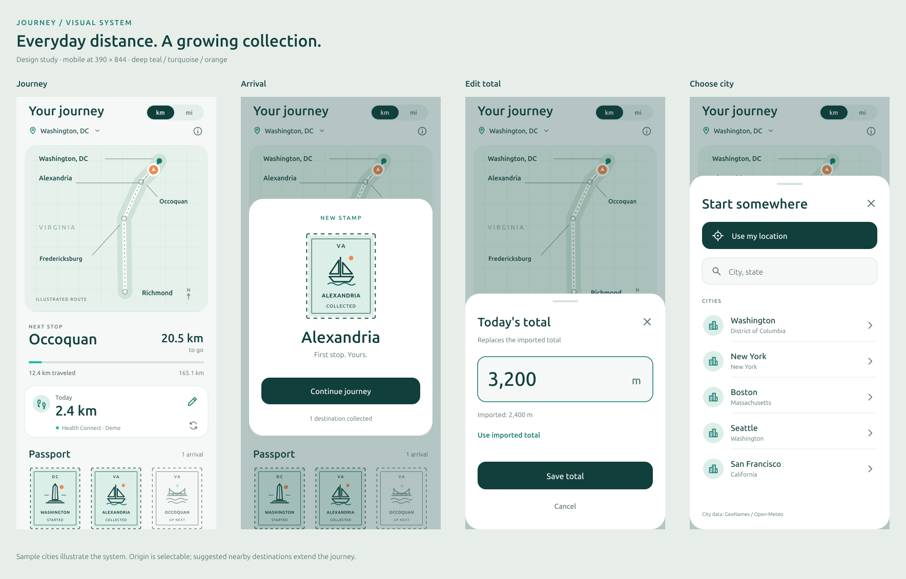
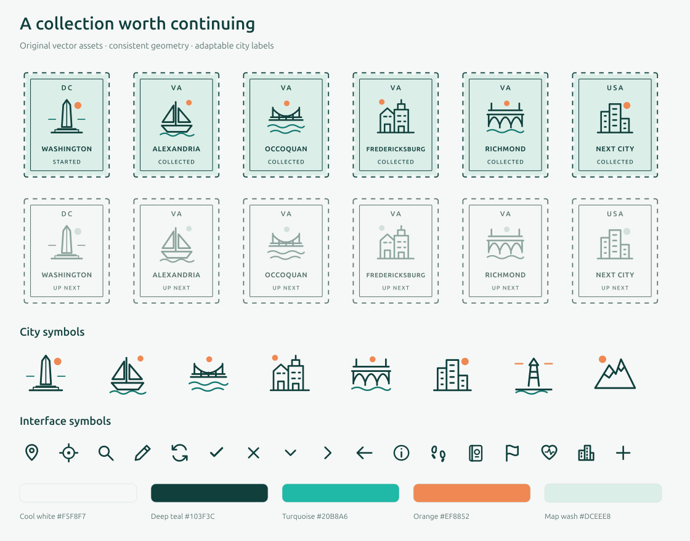

# Journey visual asset handoff

**Current review proposal:** [Playful journey map](game/README.md), with miniature landmarks and richer stamps. The original studies below remain available for comparison; use the `game/` handoff when reviewing the current direction.

Review set in cool white, deep teal, turquoise, and orange. These files precede application implementation. The DC corridor demonstrates the visual system; selectable origins and automatically suggested nearby destinations are part of the intended product.

## Preview

## Files

| Location | Contents |
| --- | --- |
| `public/journey/stamps/` | Five sample city stamps and a generic city stamp, each earned/unearned, plus a reusable blank frame |
| `public/journey/cities/` | Eight original SVG motifs: five sample places, generic city, harbor, and mountain |
| `public/journey/icons/` | Seventeen interface symbols on a 24px viewBox |
| `public/journey/maps/` | Three progress states, unlabeled base, and geographic fixture data |
| `design/journey/screen-*.svg` | Editable 390px vector screen studies |
| `design/journey/screen-*.png` | Rendered review copies of each screen |
| `design/journey/tokens.json` | Palette, spacing, radii, typography proposal, and copy limits |

The collection contains 42 reusable SVG assets and eight screen states/views, plus two boards. Screens cover metric, miles, full-page collection, arrival, manual correction, starting-city selection, disconnected health source, and syncing.

## Integration

- Use the individual SVG assets, not a screenshot of the whole screen, in the application.
- The screens are visual studies, not implemented components or interactive prototypes.
- The map fixture uses coordinate-proportional points and approximate cumulative great-circle meters. It is a schematic geographic illustration with no road or terrain claims. New origins require new geometry; do not reuse the DC picture for every city.
- Render runtime labels, progress, and distance as accessible HTML/SVG text driven by application state. Static stamp text is sample content. Use the blank frame and a suitable city motif for additional names.
- Keep SVG transparency. Stamp perforations use alpha masks rather than opaque white dots, so they work on different surfaces.
- Interface drawings are 24px; interactive wrappers must be at least 44px. The small switch in the study likewise needs a larger invisible interaction area in the app.
- `location` is a map pin, `locate` is the current-location control, and `health` is a generic activity-source icon, not the official Health Connect logo.
- Icons are original project vectors, not copied official city seals or licensed Canva stock. Named city motifs are symbolic, not exact landmark renderings.
- SVG text previews use Ubuntu Sans with system fallbacks. Typography is a review proposal; no font binaries are bundled. Rendering may vary slightly where that font is unavailable.
- Use short interface labels. The manual sheet's one-line replacement explanation prevents an important data-entry mistake. Place longer explanations in the information sheet or documentation.

## Provenance

All local SVG artwork was created specifically for this project with vector primitives. PNGs are rendered from those originals through system librsvg/Cairo. No image-generation model or third-party stock art was used for these local assets.

Sample coordinates come from the [US Census Virginia place table](https://tigerweb.geo.census.gov/tigerwebmain/Files/bas26/tigerweb_bas26_incplace_2025_acs25_va.html) and [Washington place table](https://tigerweb.geo.census.gov/tigerwebmain/Files/bas26/tigerweb_bas26_incplace_2025_acs25_dc.html). Cumulative distances were calculated from those coordinates and rounded once to meters.

A separate [Canva portrait exploration](https://canva.link/15830ispzmw7buz) was generated through the Canva connector using the selected palette and concise journey-screen brief. It is independently editable in Canva and is not an exported source for the local graphics. The connector did not expose a general stock-icon search or asset-export tool. An earlier square Canva study is superseded by the portrait study.

Application progress and the current implementation scope are recorded in `docs/plan.md`. The game-map handoff supersedes these earlier studies.
