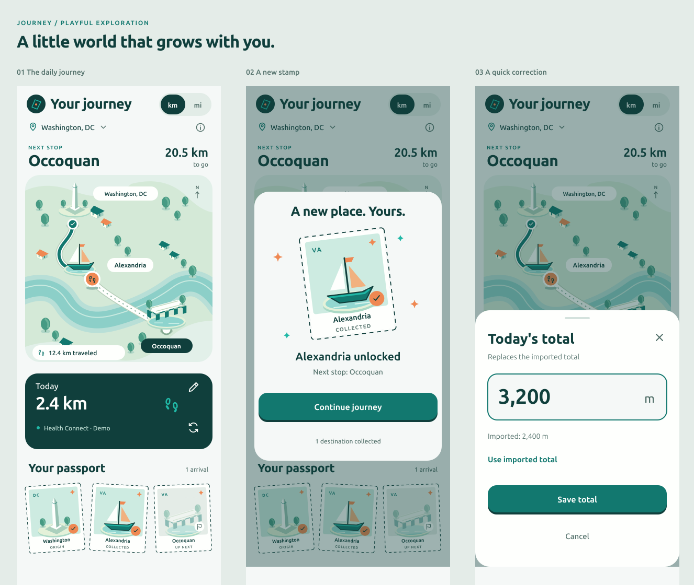
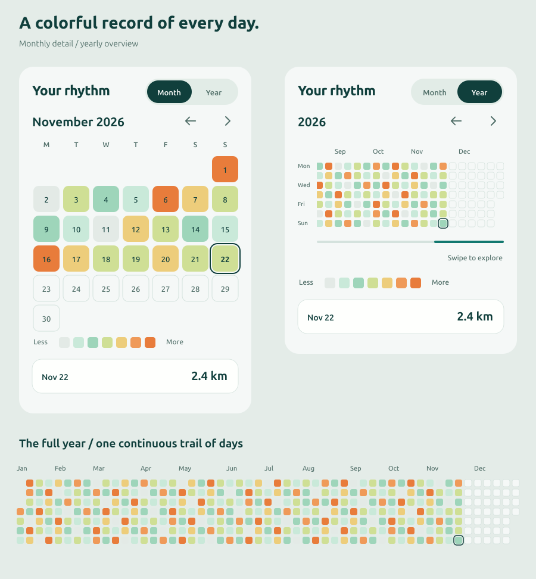

# Journey game-map study

Current visual proposal: a modern miniature travel world, with a visible trail, dimensional city landmarks, and collectible stamps. Cool white and deep teal frame turquoise scenery and small orange rewards. The interface keeps short labels and familiar mobile controls.

The [complete Canva review set](https://www.canva.com/d/wfBbyy10pavjL25) contains fourteen pages: full daily page, metric/miles, health connection/sync, arrival, correction, city selection, monthly/yearly history, the full-year strip, and three overview boards. It was imported from the local design geometry using an HTML conversion with separately positioned text. A sample page inspection verified native text elements alongside illustration image elements. The artwork is not reconstructed as individually editable Canva vector primitives; the original SVGs remain the source for that geometry. No pixel-perfect visual review of the Canva rendering has been completed. This is a review/presentation copy, not a Figma-style component library or a functioning app prototype. The earlier flattened import and single-screen Canva exploration are superseded by this set.

## Design decisions

The map carries the personality. Miniature buildings, trees, a river, and a traveler token make accumulated distance tangible. The passport repeats the same landmark art to connect traveling with collecting. A brief stamp reveal marks arrival; the rest of the interface remains calm and readable.

The proposal changes presentation, not the activity rules. Metric/miles, simulated health import, manual replacement of the daily total, location/city choice, and automatic nearby destinations remain. XP, currencies, streak penalties, leaderboards, and extra missions are not added. Daily target and longer-term goals remain open product decisions in the technical spec.

## Files

| Path | Contents |
| --- | --- |
| `public/journey/game/cities/` | Six reusable 128px miniature motifs: five sample cities and a generic skyline |
| `public/journey/game/stamps/` | Six stamp designs, each collected/future, with transparent perforations |
| `public/journey/game/scenery/` | Reusable tree and house |
| `public/journey/game/traveler.svg` | Journey-position token |
| `public/journey/game/maps/` | Two static sample map states |
| `design/journey/game/screen-*.svg` | Ten editable screen studies, including full scroll, monthly history, and yearly history |
| `design/journey/game/*.png` | Rendered review previews |
| `design/journey/game/tokens.json` | Palette, type, shape, and motion proposal |
| `design/journey/game/year-contribution-grid.svg` | Complete continuous-year strip for review |
| `design/journey/game/history-sample.json` | Deterministic history-only design fixture and six-color ramp |

There are 23 reusable SVG assets and fourteen screen/board SVGs with corresponding PNGs. Existing 24px interface icons in `public/journey/icons/` are reused.

## Monthly and yearly history

Your rhythm follows the collection in the full-page study. Month is the default proposal: one square per day, green-to-orange intensity, and a date/distance readout. Year uses a GitHub-style continuous contribution grid: seven weekday rows, one column per week, and month labels along the top. Monthly squares are 44px in the 390px study; narrower screens need a seven-column roving-focus calendar and readable selection readout. Keep arrows and the switch at least 44px. The yearly grid scrolls horizontally within the page, retaining readable squares rather than compressing an entire year to phone width. The static preview shows the later part of the year; the full-year strip below shows all days. In implementation, initially reveal the current week, use roving keyboard focus and arrow-key date selection, and show exact values in the selected-day readout. Keep Month available for precise touch selection and avoid overlapping hit areas. Preserve vertical page scrolling during horizontal gestures.

The proposed intensity uses six equal distance bands from zero to the displayed period's maximum effective daily distance. One scale applies to the entire year in Year mode. Zero is neutral; future dates are outlined. Missing records must read as unrecorded, not inferred zero. Changed maxima may recolor a period; switching units cannot. Numbers and accessible names supply exact information alongside color. Streak counts and missed-day penalties are not introduced.

`history-sample.json` is an independent visual fixture ending November 22, 2026. It demonstrates a populated history rather than reconciled lifetime journey totals. Consolidate this and the earlier 12.4km route fixture into one consistent sample account before implementing. Actual views must derive from the same corrected daily records. The contribution-grid layout follows the requested yearly direction; detailed scale and interaction behavior remain review proposals.

## Implementation handoff

- These are static design studies, not working app screens. Keep text and controls as real accessible UI; do not implement the page as one image.
- The artwork uses **schematic display geometry**. Terrain, river, houses, and curved trail are illustrative, not surveyed geography or walking directions. This is a proposed change from the earlier coordinate-proportional map and needs visual review before implementation.
- Calculate travel thresholds from actual city coordinates separately. Reuse the existing `public/journey/maps/sample-route.json` meter fixture for the sample, not the decorative curve length. The fixture gives 10,000 prior meters plus 2,400 imported meters, one arrived destination, and 20,450 meters remaining to Occoquan.
- For new origins, compose the chosen cities into the illustrated layout with their own coordinates, names, and distances. Do not present the Washington artwork as every user's physical location. Unknown places use the generic skyline, not another city's landmark.
- In the app, calculate the traveler position from the effective distance fraction along the current display segment. The fixed token in these screenshots is only a sample. Live labels, collected/future states, and progress must derive from shared application data.
- Future stamps have a faded illustration plus an explicit label; color alone is insufficient. Origin is separate from destination count. Replace sample text with actual city labels; accommodate long names on two lines without shrinking them excessively.
- Preserve a minimum 44px target for icon controls. The unit control here has two 47px-wide segments inside a 44px-high wrapper. Health controls and correction remain available in all relevant states.
- At short phone heights, the passport continues below the fold. Keep the map, remaining distance, and today's activity in the main scroll flow. Sheets must fit the available viewport and scroll internally when the keyboard opens.
- Typography uses Ubuntu Sans, with a heavy title weight and regular supporting text. No font binaries are bundled; choose a properly licensed font delivery method during implementation and check actual metrics.
- Motion proposal: a 120ms press response and a 400ms stamp entrance using transform/opacity. Arrival happens once per newly reached city; re-sync cannot replay it. Reduced motion shows the final state immediately. No animation runtime is needed for these static assets.

## Validation and provenance

All artwork is original SVG geometry created for the project. No stock art or generated raster model output is included. PNGs were rendered from the SVGs using librsvg/Cairo and visually inspected. City motifs are symbolic illustrations, not official seals. The application uses the finished assets directly and requires no Python tooling.

The previous travel-journal study remains in the parent directory for comparison. This proposal is not yet an approved implementation reference.
