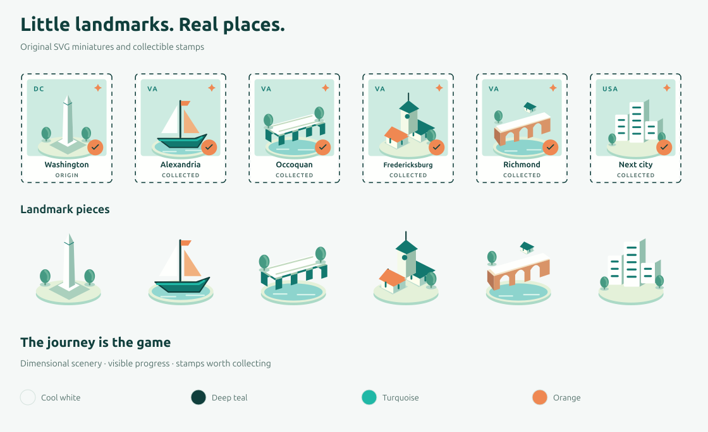

# Journey game-map study

Current visual proposal: a modern miniature travel world, with a visible trail, dimensional city landmarks, and collectible stamps. Cool white and deep teal frame turquoise scenery and small orange rewards. The interface keeps short labels and familiar mobile controls.

The [complete Canva review set](https://www.canva.com/d/wfBbyy10pavjL25) contains fourteen pages: full daily page, metric/miles, health connection/sync, arrival, correction, city selection, monthly/yearly history, the full-year strip, and three overview boards. It was imported from the local design geometry using an HTML conversion with separately positioned text. A sample page inspection verified native text elements alongside illustration image elements. The artwork is not reconstructed as individually editable Canva vector primitives; the original SVGs remain the source for that geometry. No pixel-perfect visual review of the Canva rendering has been completed. This is a review/presentation copy, not a Figma-style component library or a functioning app prototype. The earlier flattened import and single-screen Canva exploration are superseded by this set.

## Design decisions

The map carries the personality. Miniature buildings, trees, a river, and a traveler token make accumulated distance tangible. The passport repeats the same landmark art to connect traveling with collecting. A brief stamp reveal marks arrival; the rest of the interface remains calm and readable.

The proposal changes presentation, not the activity rules. Metric/miles, simulated health import, manual replacement of the daily total, location/city choice, and automatic nearby destinations remain. XP, currencies, streak penalties, leaderboards, and extra missions are not added. Daily target and longer-term goals remain open product decisions in the technical spec.

## Files

| Path | Contents |
| --- | --- |
| `public/journey/game/cities/` | Six reusable 128px miniature motifs: five sample cities and a generic skyline |
| `public/journey/game/stamps/` | Six stamp designs, each collected/future, with transparent perforations |
| `public/journey/game/scenery/` | Reusable tree and house |
| `public/journey/game/traveler.svg` | Journey-position token |
| `public/journey/game/maps/` | Two static sample map states |
| `design/journey/game/screen-*.svg` | Ten editable screen studies, including full scroll, monthly history, and yearly history |
| `design/journey/game/*.png` | Rendered review previews |
| `design/journey/game/tokens.json` | Palette, type, shape, and motion proposal |
| `design/journey/game/year-contribution-grid.svg` | Complete continuous-year strip for review |
| `design/journey/game/history-sample.json` | Deterministic history-only design fixture and six-color ramp |

There are 23 reusable SVG assets and fourteen screen/board SVGs with corresponding PNGs. Existing 24px interface icons in `public/journey/icons/` are reused.

## Monthly and yearly history

Earlier horizontal history study (superseded by the vertical runtime layout described below): Your rhythm follows the collection in the full-page study. Month is the default proposal: one square per day, green-to-orange intensity, and a date/distance readout. Year uses a GitHub-style continuous contribution grid: seven weekday rows, one column per week, and month labels along the top. Monthly squares are 44px in the 390px study; narrower screens need a seven-column roving-focus calendar and readable selection readout. Keep arrows and the switch at least 44px. The yearly grid scrolls horizontally within the page, retaining readable squares rather than compressing an entire year to phone width. The static preview shows the later part of the year; the full-year strip below shows all days. In implementation, initially reveal the current week, use roving keyboard focus and arrow-key date selection, and show exact values in the selected-day readout. Keep Month available for precise touch selection and avoid overlapping hit areas. Preserve vertical page scrolling during horizontal gestures.

The proposed intensity uses six equal distance bands from zero to the displayed period's maximum effective daily distance. One scale applies to the entire year in Year mode. Zero is neutral; future dates are outlined. Missing records must read as unrecorded, not inferred zero. Changed maxima may recolor a period; switching units cannot. Numbers and accessible names supply exact information alongside color. Streak counts and missed-day penalties are not introduced.

`history-sample.json` is an independent visual fixture ending November 22, 2026. It demonstrates a populated history rather than reconciled lifetime journey totals. Runtime history now uses the reconciled August–November account in `data/sample.json`, including completed Brazil travel and past Washington activity; this independent visual fixture is not loaded by the application. Actual views must derive from the same corrected daily records. The contribution-grid layout follows the requested yearly direction; detailed scale and interaction behavior remain review proposals.

## Implementation handoff

- These are static design studies, not working app screens. Keep text and controls as real accessible UI; do not implement the page as one image.
- The artwork uses **schematic display geometry**. Terrain, river, houses, and curved trail are illustrative, not surveyed geography or walking directions. This is a proposed change from the earlier coordinate-proportional map and needs visual review before implementation.
- Calculate travel thresholds from actual city coordinates separately. Reuse the existing `public/journey/maps/sample-route.json` meter fixture for the sample, not the decorative curve length. The fixture gives 10,000 prior meters plus 2,400 imported meters, one arrived destination, and 20,450 meters remaining to Occoquan.
- For new origins, compose the chosen cities into the illustrated layout with their own coordinates, names, and distances. Do not present the Washington artwork as every user's physical location. Unknown places use the generic skyline, not another city's landmark.
- In the app, calculate the traveler position from the effective distance fraction along the current display segment. The fixed token in these screenshots is only a sample. Live labels, collected/future states, and progress must derive from shared application data.
- Future stamps have a faded illustration plus an explicit label; color alone is insufficient. Origin is separate from destination count. Replace sample text with actual city labels; accommodate long names on two lines without shrinking them excessively.
- Preserve a minimum 44px target for icon controls. The unit control here has two 47px-wide segments inside a 44px-high wrapper. Health controls and correction remain available in all relevant states.
- At short phone heights, the passport continues below the fold. Keep the map, remaining distance, and today's activity in the main scroll flow. Sheets must fit the available viewport and scroll internally when the keyboard opens.
- Typography uses Ubuntu Sans, with a heavy title weight and regular supporting text. No font binaries are bundled; choose a properly licensed font delivery method during implementation and check actual metrics.
- Motion proposal: a 120ms press response and a 400ms stamp entrance using transform/opacity. Arrival happens once per newly reached city; re-sync cannot replay it. Reduced motion shows the final state immediately. No animation runtime is needed for these static assets.

## Runtime comparison

The implemented page follows `docs/plan.md`: map/next stop, today's activity,
monthly or yearly history, then the passport. The full-page study above shows an
earlier order with the passport before history. The header uses the selected city
control and unit switch; it does not introduce a separate settings or information flow.

The illustrations and palette remain the source for the interface. Runtime labels,
route windows, and stamp states follow the selected cities and activity. Stamp frames
are slightly taller (184 rather than 172 design units) to reserve space for two-line
names. The arrival overlay keeps the illustrated stamp and sparks, with a compact
layout for short phone heights. Passport browsing expands inline with native controls.

The source history studies show an illustrative populated account. Runtime history
shows only the shared sample's recorded days, distinguishing missing, zero, and future
dates. Year is now a continuous vertical week grid in the page flow. The earlier horizontal studies below are retained as design references. Browser
comparisons and measurements are recorded in the feature plan; the static studies
remain design references rather than screenshots of the running app.

## Validation and provenance

All artwork is original SVG geometry created for the project. No stock art or generated raster model output is included. PNGs were rendered from the SVGs using librsvg/Cairo and visually inspected. City motifs are symbolic illustrations, not official seals. The application uses the finished assets directly and requires no Python tooling.

The previous travel-journal study remains in the parent directory for comparison. This proposal is not yet an approved implementation reference.

## Country expansion

The populated account includes original Brasília and Goiânia motifs. Brasília references the National Congress towers and bowls; Goiânia uses symbolic Art Deco architecture rather than a named attraction. Washington references the Washington Monument. The remaining original motifs are city-inspired architecture or bridge illustrations, not verified replicas or landmark locations. Stamps place artwork at the city level, not at a tourist attraction’s coordinates. New city data is credited in `data/cities.json`; Brasília uses approximate city-center coordinates from IBGE’s capital tables.

The runtime map now uses real geography with Leaflet 1.9.4: drag, pinch, zoom controls, tappable city symbols, country framing, and return-to-route framing. Original city motifs remain in markers and stamps. Natural Earth’s 1:110m outlines for the United States and Brazil are bundled in `data/country-maps.json` (13.6kB, coordinates rounded to five decimals). Source: [Natural Earth country data](https://github.com/nvkelso/natural-earth-vector/blob/master/geojson/ne_110m_admin_0_countries.geojson), [public-domain terms](https://www.naturalearthdata.com/about/terms-of-use/). Street tiles come directly from [OpenStreetMap](https://www.openstreetmap.org/copyright), with visible attribution; no street tiles are bundled, downloaded for offline use, or prefetched. The local vector outlines and route remain interactive when tiles are unavailable. The country button frames the contiguous United States or Brazil; Alaska and Hawaii remain in the US geometry and can be reached by panning. City-center markers and straight virtual segments are not attraction coordinates or walking directions. The static game boards above document the earlier visual direction; runtime geography supersedes their schematic trail layout.

Leaflet is BSD-2-Clause; its notice is retained in [the bundled license](../../../docs/licenses/leaflet-BSD-2-Clause.txt). Runtime dependencies are installed normally by npm; no CDN script is required.

The current start flow supersedes the fixed Washington screen studies: the page opens with no city, recorded activity, or collected stamps and an original-art start panel offering city selection or GPS. Each different origin creates an automatic itinerary at zero. The map badge shows current journey distance; its caption keeps lifetime distance separate. A route-specific mock reading is prepared on selection and imported only on sync, so any supported origin can demonstrate its first arrival. The first successful sync also fills past activity and country stamps once, without spending that history on the new route. Country passport views follow the starting city by default while the calendar remains global.

## Capital milestone tier

National and state capitals share a gold/orange stamp tier, with a double gold frame, star medallion, and explicit Capital label. Future capitals retain muted artwork and an unearned status. Ordinary cities use the standard teal stamp without a tier emblem. The same seal appears on capital map symbols, and arrivals use a Capital milestone heading. These are presentation differences; geography, nearest-city ordering, and earning thresholds remain unchanged.

The original artwork is composed in native SVG by CityStamp; no downloaded decorative assets or new generator are needed. `data/capitals.json` is a factual identity lookup for US/Brazil capitals, not a larger route catalog. Sources: [Minnesota Legislative Reference Library state-capital table](https://www.lrl.mn.gov/docs/2013/other/130551.pdf), [University of Alabama geography map](https://alabamamaps.ua.edu/contemporarymaps/usa/basemaps/uscapz2c.pdf), [IBGE territorial divisions](https://educa.ibge.gov.br/jovens/conheca-o-brasil/territorio/19637-divisao-territorial.html), and [IBGE political map](https://geoftp.ibge.gov.br/cartas_e_mapas/mapas_do_brasil/politico/brasil_politico5000k_2023.pdf). Names, state codes, and national/state roles are factual data; no source prose or map artwork is reproduced.

The current history layout supersedes the horizontal yearly studies: seven weekday columns, continuous week rows, and month labels down the left, without internal scrolling. Initial selection is yesterday relative to the shared demo clock; choosing another day remains available.

Runtime motion uses short opacity/transform reveals for the start, selected map, and Month/Year content. The initial skyline and marker move subtly for a finite duration. Arrival layers fade in around the stamp and fade out before dismissal; reduced motion disables these effects and their delay.

Connected itinerary refinement: the full planned route is drawn. Each settled map movement can append six more stops, with no fixed total lookahead cap. Discovery checks the viewport and the latest route endpoint, supplying candidate cities to the state-first planner without reordering existing legs. Local route stops use standalone city artwork with warm radial halos fading to transparent, without frames or solid panels. The next stop is larger with a coral-orange halo and permanent label; capitals retain gold halos and seals. Crowded lower-priority icons and country views use compact dots; zooming reveals more illustrations as screen space permits. All stops retain kilometer popups. Street tiles render at 30% opacity over dark teal, beneath bright mint route lines and turquoise completed segments. The three-stop window remains the initial/recenter framing.

Arrival confetti now spans the visible viewport above the stamp modal, using a pointer-free native popover. Forty-eight teal/orange/gold pieces fall once; reduced motion hides them. Future passport artwork and frames are more subdued, while captions remain readable and collected stamps retain full color. A small map status pill indicates pending city discovery.

### Origin-centered reach

The current runtime supersedes the connected trail studies above. Accumulated walking/running meters define a geographic radius centered permanently on the selected origin. Every discovered eligible city within it unlocks independently. A translucent mint circle and a single dashed spoke to the nearest future discovery replace cumulative city-to-city lines and the moving traveler. Existing frameless landmarks, warm halos, gold capital tier, collision dots, and dark teal base remain. Sample route thresholds now use direct origin distance; static boards and their old numbers are historical references.
