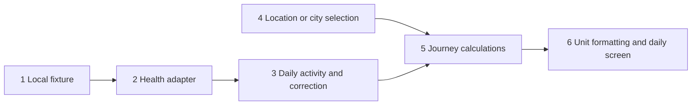
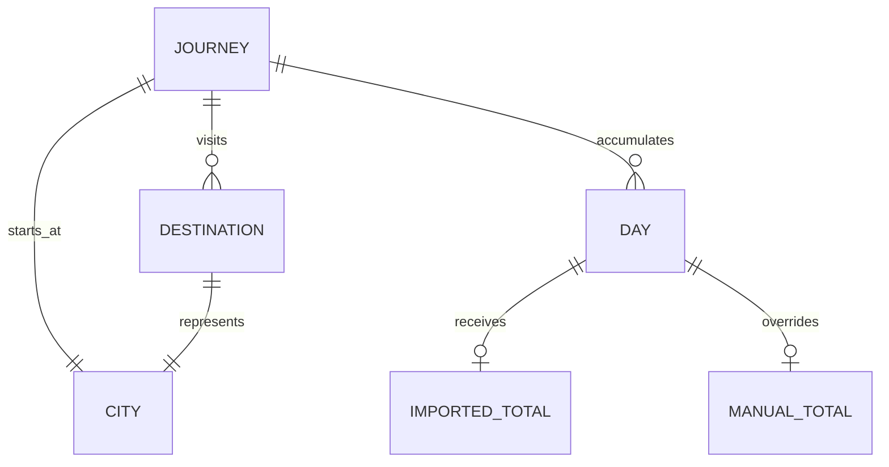
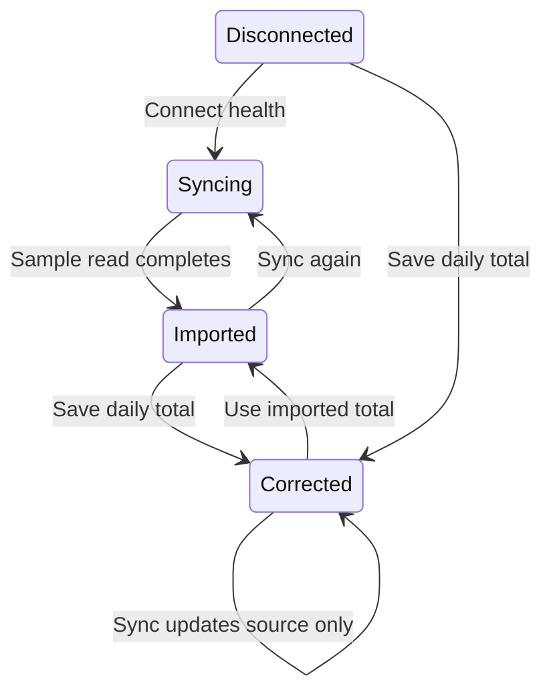

# Journey activity tracker

**Status:** The core daily experience was independently reviewed at `7dd23f8`. Subsequent increments add presentation controls, populated account history, and interactive country maps. Optional product choices remain explicit below.

This file is the feature's authoritative documentation. It holds requirements,
product and technical decisions, rationale, open questions, implementation status,
and validation. Keep it current alongside the code rather than creating separate
ADRs or decision registers. Linked design handoffs and skill manifests supply
supporting assets and provenance. Requirements describe intended behavior;
Implementation progress identifies what is actually delivered. Proposals and open
questions remain labeled until settled. When a decision changes, revise the
affected sections and criteria together; Git records the previous version.

## Problem

Repeated local walks accumulate distance without a lasting sense of discovery. A daily activity total provides immediate feedback, but little to collect or continue over several months. The product hypothesis is that a virtual journey through real places can make that accumulated effort more meaningful.

The daily screen will show activity advancing a journey, the next destination, and a growing passport collection. Activity arrives through a simulated health connection and can be corrected manually. The demo waits for a tap on the sync icon before importing its next reading, allowing the initial journey to be presented before an arrival. Distances are available in metric and imperial units.

## Decision rationale

| Area | Decision | Reason |
| --- | --- | --- |
| Habit and retention | Walking and running distance advances travel between real cities and collects city stamps | Turn repeated local activity into visible exploration and a collection that grows over months |
| Daily interaction | Simulated health totals triggered by demo sync, plus manual replacement of a day's total | Reduce daily effort while allowing a clear correction without double-counting |
| Units | Support metric and miles, including meter entry; store integer meters | Make the interface familiar across audiences and prevent display conversions from changing progress |
| Rewards | Recalculate active-route stamps from effective distance; archive earned stamps when changing origin; track arrival announcements separately | Keep collection and progress consistent after corrections while avoiding repeated arrival dialogs on sync |
| Origin and journey | Offer browser location and city selection; suggest nearby destinations first and extend automatically | Make the journey personal without requiring itinerary planning |
| Presentation | One scrolling page with a prominent playful map, compact activity card, inline history and passport, and contextual sheets | Preserve the main daily moment on a phone while allowing deeper exploration on the same route |
| Visual identity | Cool white, deep teal, turquoise, restrained orange, miniature landmarks, and collectible stamps | Give the journey a playful, modern, gender-neutral identity with concise interface copy |
| History | Monthly day squares and a continuous GitHub-style yearly grid, using green-to-orange distance intensity | Show daily consistency and accumulated activity at two time scales |
| Architecture | Keep the scaffold, local JSON, in-memory React state, and independently testable distance rules | Keep the app small, runnable without accounts or services, and straightforward to extend live |
| Graphics | Use the finished local SVG assets; retain PNGs as design references | Preserve scalable artwork while rendering live labels and controls from application state |
| Styling | Plain CSS with shared tokens and a local font fallback | Keep visual rules explicit and avoid adding a component framework or build-time font download |
| Delivery | One feature branch and incremental commits with relevant checks | Keep each change reviewable and its behavior easy to explain |

Detailed behavior and remaining choices are specified below. These decisions do
not imply that every planned capability is already implemented.

## Shape

Reuse the existing Next.js, React, TypeScript, and local JSON scaffold. Keep distance conversion, source reconciliation, destination selection, and reward rules in pure functions that can be tested independently of rendering.

1. `data/sample.json` (exists) supplies sample activity and geographic fixtures through `lib/data.ts` (exists).
2. A health-source adapter (new) simulates an asynchronous distance import into daily activity state. Stable source/day identities prevent duplicate imports.
3. `app/components/daily-total-editor.tsx`, opened by `app/page.tsx`, edits an optional manual correction for the same day. The page dispatches it to the journey reducer; the correction replaces the imported total.
4. Browser geolocation or city selection supplies an origin. `lib/cities.ts` normalizes public city results and falls back to `data/cities.json`. `lib/places.ts` ranks nearby destinations and extends routes using city coordinates.
5. Journey calculations (new) derive accumulated meters, upcoming destinations, and earned stamps from effective daily activity and the selected origin.
6. `lib/distance.ts` formats metric/miles and converts editor values to canonical meters; `app/page.tsx` displays the journey using reusable vector assets.

New: in-memory activity, origin, destination, route offset, previous journey snapshots, and presentation state. These entities do not imply a database.

The editor offers “Use imported total” when a manual correction exists; it restores the latest source reading and closes the sheet.

| Existing surface | Change |
| --- | --- |
| Root page | Replace the scaffold with one mobile daily experience and contextual sheets |
| Sample goal data | Replace placeholder items with activity and geographic fixtures |
| Styling | Introduce a consistent teal vector visual system |
| Persisted data | No migration; persistence policy is still open |

## Surface

| Surface | Input | Output | Access |
| --- | --- | --- | --- |
| `/` | Activity source, daily correction, units, starting location | Journey, current distance, next city, collected stamps | Public; no account |
| Browser location | Explicit tap on “Use my location” | Coordinates or a manual-selection fallback | Browser permission; secure context |
| City search | City name and optional state | Named matches with coordinates | Public API with local fallback |

No application backend, authentication, payment processing, or native health SDK is introduced.

### One-page composition

Use one route, `/`, implemented through `app/page.tsx`, with vertical scrolling.
The default order is journey map/next city, today's activity, activity history,
then a compact passport preview that expands inline. The Month / Year switch
replaces the history content in place. City selection and daily correction use
contextual bottom sheets; arrival uses a transient overlay on the same page.
Only the yearly grid has internal horizontal scrolling. No separate history,
passport, settings, or onboarding routes are required.

The static boards depict states of this page, not additional routes. The existing
full-page artwork places the passport before history; use the composition above
when implementing. The asset handoff’s Runtime comparison records the implemented order and the differences from the original studies.

## Technical decisions

### Distance and activity

- Store canonical distance in integer meters. Convert decimal miles once at entry using 1 mile = 1,609.344 meters; round only when accepting the physical value.
- Effective daily distance is `manualOverrideMeters ?? importedMeters ?? 0`. Zero is a valid correction.
- Merge imports by source/day identity. Re-reading an identical source record cannot add distance or repeat an arrival.
- Keep the imported value when a manual override exists. A later import must not silently remove the correction.
- Formatting never writes back into stored distance. Repeated unit switches and unchanged saves must not introduce rounding drift.
- The habit is walking and running distance. Health integration is a local simulation identified by a compact “Demo” label. After the sync icon is tapped, it updates the journey without a manual distance entry or second save. Loading the page alone does not request the demo reading.
- Active-route stamps are recalculated from corrected accumulated distance. Stamps archived by an origin change remain collected. Arrival announcements are tracked separately so an identical re-sync cannot replay them.
- The current default is metric, matching the existing design and first slice. Summaries show kilometers or miles to one decimal at most; metric editing uses whole meters, while miles editing shows up to three decimal places. The unit selection is in memory and affects presentation only.
- The editor captures its starting value. Saving an unchanged displayed value, including equivalent numeric formatting, preserves the original integer meters instead of converting the rounded display back. A changed value is converted and rounded once on save. Empty, negative, non-numeric, fractional-meter, and unsafe-size entries remain unsaved with a short inline error.
- Saving or restoring an imported total closes the sheet; cancel, close, backdrop dismissal, and Escape discard the draft. “Use imported total” is available when a manual correction exists and restores the latest imported reading. Imports may update their source record while the sheet is open but do not rewrite its draft. Pending arrival notices for cities no longer reached are removed after a downward correction.

### Origin and city discovery

- Use `navigator.geolocation.getCurrentPosition` on an explicit gesture for starting-location coordinates. This requires no paid service or API key; the browser requests permission and uses its available location providers.
- Location establishes an origin; it does not record the person's walking route or measure daily activity. Health data and manual totals supply that distance.
- Offer manual city search independently of location permission. A location denial or timeout keeps the picker usable. Simulation, when needed for a demo, is explicitly marked rather than presented as a measured location.
- Photon replaces the initial Open-Meteo proposal because it supplies both city search and nearby place lookup through one no-key service. Use explicit search submissions rather than network requests on every keystroke. Its public demo permits reasonable project use without an availability guarantee; keep requests bounded and retain a local fallback. No self-hosted geocoder is introduced.
- Search uses Photon's city-layer forward endpoint. Nearby discovery uses its coordinate-based reverse endpoint, requesting up to twenty settlements within 100km. Normalize only named cities/towns with valid point coordinates. Time out requests after four seconds and abort obsolete searches or closed-sheet requests. Location permission denial leaves city selection usable.
- `data/cities.json` bundles 64 sample settlements around Washington, New York, Boston, Seattle, San Francisco, and Brasília/Goiânia, including a longer New York corridor. Brazilian state aliases normalize to DF/GO, and saved Brasília/Goiânia choices are available without a city-service response. OSM-derived data is credited to OpenStreetMap/Photon; the original DC corridor uses Census coordinates. This is a demonstration fallback, not a comprehensive global city catalog.
- Use the city name, state, and country to distinguish duplicate names. Normalize external results behind one adapter. Do not treat a text-search endpoint as a radius/nearby-city service.
- Rank available destination candidates by geographic distance from the current stop, exclude already visited place identities, and extend the journey while retaining the existing route prefix. Maintain two upcoming destinations where available. Use great-circle distances rounded once per segment, with candidate legs between 1km and 250km. The minimum avoids effectively colocated stops; the maximum prevents a sparse fallback from silently suggesting a cross-country jump. These are demo bounds, not road distances or a walking-navigation service.
- Fetch additional candidates near the last known stop when fewer than two upcoming destinations remain. Candidate exhaustion leaves existing progress intact and keeps city selection available; no invented coordinates or city names fill gaps. Normalize city/state/country identity and provider aliases so known places keep their original artwork and coordinates.
- Geolocation supplies coordinates, not a city name. Resolve the name from a sufficiently complete local city catalog, or leave it as “Current location” and offer city selection. Do not label a far-away catalog entry as the detected city. The example map is not a fixed origin or itinerary.
- Changing the starting city preserves all daily records, manual overrides, previous journey snapshots, and already collected stamps (including origin stamps). Only distance beyond the last reached checkpoint transfers into the new route. For example, 12,400 total meters with the last checkpoint at 11,117 transfers 1,283 meters. Repeated changes without activity preserve that remainder. Selecting the same city is a no-op.
- Store a route offset in meters: active distance is `max(0, effective lifetime distance - route offset)`. On an origin change, set the offset to lifetime distance minus the carried remainder. The map uses active distance while the traveled total remains lifetime distance. Corrections continue to change daily history and active progress; previously archived stamps stay collected. A correction below the offset clamps active distance to zero; later activity first covers that difference.
- Archive the departing route and its effective distance before replacement. Exclude archived collected cities from future destination candidates and deduplicate passport stamps by normalized place identity. Reject a proposed origin without enough genuine nearby candidates to render its route, leaving the existing journey intact.

### Visual system and content

- Palette: cool white, deep teal, turquoise, and restrained orange accents. The current proposal's tokens are in `design/journey/game/tokens.json`.
- The journey map and passport collection are the primary visual features. The game-inspired presentation keeps miniature city symbols and collectible stamps around an interactive geographic map with an orange progress marker. Keep the contemporary travel character and concise mobile controls.
- The map uses real geography through Leaflet 1.9.4, with direct OpenStreetMap street tiles and bundled Natural Earth country outlines for US/BR. Dragging, pinch zoom, keyboard controls, explicit 44px zoom buttons, country framing, and return-to-route framing keep exploration on the same page. Street tiles require no key; five seconds without a loaded tile or a tile error exposes an offline-outline status while local geometry and route controls remain available. Visible OSM/Natural Earth credit stays on the map. No tile prefetch, offline tile download, proxy, or new backend is introduced; normal browser caching and referrers are retained. Public OSM tile availability is not guaranteed; production-scale use would need a suitable provider.
- City markers use city-center coordinates and safe DOM text for names/popups. Display segments join real cities with straight virtual lines; distance thresholds still use rounded great-circle meters. The orange progress point interpolates within the current segment and does not represent measured GPS activity or a road route. Country-scale views replace overlapping city art/labels with small pins; route framing restores the detailed symbols. The US country view frames the contiguous states; Alaska and Hawaii remain browsable. No XP, currency, or streak mechanics are implied.
- Keep the default screen free of explanatory paragraphs. Prefer section headings of up to three words and button labels of up to four words. Keep necessary explanations in contextual sheets or project documentation.
- Sheets dismiss on taps outside their actual bounds, not on their own padding. The mobile viewport requests content resizing for the on-screen keyboard, while retaining normal zoom. Inputs advertise Search/Done keyboard actions. The origin control wraps long labels and exposes its current city as an accessible description.
- Calendar day text uses a stronger dark teal to maintain contrast on the highest orange distance band. Colors still derive from the same period intensity calculation.
- Icon-only controls retain accessible names and 44px interaction areas. An icon's drawing size is not its touch-target size.
- Use familiar sheets for city selection and manual correction. Retain only short explanatory copy where it prevents a material mistake, such as “Replaces the imported total.”
- Use local SVGs for reusable artwork. Origin, route points, city labels, and live progress remain data-driven. The supplied geographic route is a visual fixture, not the production map for every city.
- City-specific motifs are available for the sample collection, with neutral city, harbor, and mountain motifs for extension. Never associate a specific landmark illustration with an unrelated city.
- Stamps include earned and future variants. Long city names need readable wrapping or an adjacent HTML label, not arbitrarily shrinking text.
- Map labels, city symbols, and the three-stop map window follow the route and progress. Panning/zooming is preserved on ordinary distance updates; changing the origin or visible route window reframes the route. Mouse wheel zoom is off to preserve page scrolling, while pinch, keyboard, and buttons zoom the map. ResizeObserver updates the viewport without recreating the map. The browser-only library loads inside an effect and removes its listeners/map on cleanup, keeping server rendering safe. Known sample cities reuse their original motifs; other places use the generic skyline. Runtime stamp frames compose the existing motif with the actual city label and earned state, avoiding static sample text for unrelated places.

### Passport and arrivals

- Keep the passport preview to at most three unique places: the current origin, latest collected destination other than that origin, then upcoming stops. Before any arrival, upcoming places fill the available slots. When no future destination is available, other collected stamps fill the preview. The count represents distinct destination arrivals, excluding origin-only stamps and upcoming places.
- A native inline disclosure reveals remaining stamps, with separate “More collected” and “Next discoveries” groups where needed. Do not repeat stamps already in the preview. Keep the control absent when everything is already visible. Disclosure changes only presentation; the reducer remains the source of earned and archived rewards.
- The page derives one passport model in `lib/passport.ts` from the current route, corrected activity, and archived journeys, then passes that model to the collection. The same destination count appears in the arrival overlay. Collapsing the collection does not change progress, rewards, or the history view.
- Keep the existing stamp motifs, perforated frames, and explicit Origin/Collected/Up next labels. Allow two caption lines at the same readable size, extending the frame to avoid artwork overlap. Preserve full place names in accessible labels and native name tooltips. Unknown cities keep the generic skyline.
- Arrival uses the existing brief stamp animation and restrained orange/turquoise sparks. A native modal shows the actual city and next destination, focuses “Continue journey,” contains Tab focus, and supports Escape. On dismissal, restore the previous connected control, falling back to the health-sync button for an automatic first arrival. Queued arrivals are shown in route order once; corrections remove notices no longer earned. Reduced motion shows the final stamp immediately. No XP, reward currency, or separate passport route is introduced.

### Activity history

- Add a monthly calendar after today's activity and before the passport, with one square per calendar day. A Month / Year switch offers a GitHub-style contribution grid: seven weekday rows and continuous week columns, with month labels across the top. The year never restarts into separate monthly calendars. The grid scrolls horizontally inside its own mobile container; the page itself stays within the viewport.
- The proposed six-band scale goes from pale green through yellow-green and amber to orange: `#C9E9D9`, `#9ED5BA`, `#CFDF95`, `#EDCD7B`, `#EF9A59`, `#E87C3B`. Use equal distance bands from zero to the maximum effective daily meters in the displayed month or year; one scale applies throughout the displayed period. A revised maximum may recolor the period. Unit switching cannot recolor it. This is distance intensity, not goal completion.
- Confirmed zero is neutral; future dates are outlined. Missing records remain unrecorded, not inferred zero. Guard periods with no positive values against division by zero. Use a short Less / More key and a selected-day date/distance readout.
- Keep day numbers and a selected outline. Monthly squares expose date and distance through accessible names and keyboard navigation. The yearly grid uses roving keyboard focus and arrow-key date selection with an exact date/distance readout. Keep a monthly view for precise touch selection; do not assign overlapping 44px targets to densely packed yearly cells. Use a seven-column roving-focus calendar on narrow screens rather than making the page wider.
- Year view uses one set of continuous Monday-first week columns with padding only outside January 1–December 31. Month labels sit over the week containing their first day. Weekday labels remain visible while the strip scrolls. Changing views preserves the selected date; Year initially reveals that date (today by default) without moving the entire page.
- Year keyboard arrows follow the visible grid: left/right move seven days, up/down one day. Home/End select the same week’s Monday/Sunday; Page Up/Down move one year, clamping leap days. Crossing a year boundary updates the displayed year and keeps focus on the selected date. Year arrows in the header preserve the selected month/day where possible. Dense year squares retain precise accessible names; the monthly calendar provides large touch targets.
- Monthly navigation follows the Monday-first design. Arrow keys move one day or week, Home/End move to the week boundaries, and Page Up/Down move months. Month changes preserve the day number where possible and clamp it for shorter months. Selection moves with the displayed month; future and unrecorded dates remain selectable for their status readout. Only one day is in the Tab sequence.
- Group records by the same local calendar dates as the daily editor, respecting the configured timezone, real month lengths, weekday offsets, and leap years. Do not derive local dates by slicing UTC timestamps.
- All runtime history, daily totals, and journey calculations use the same effective activity records, including corrections and valid zero values. `data/sample.json` supplies the single runtime account; the monthly calendar reads reducer state directly. The separate history design fixture illustrates a longer account and is reference-only: its distances are not loaded as a second activity source. The initial runtime history is intentionally short, so earlier dates remain unrecorded rather than showing invented activity.
- Date-only values already identify the local calendar day in the configured account timezone. Use UTC noon solely for date arithmetic and explicit UTC formatting of those date-only values; do not reinterpret activity dates using the browser timezone. The demo clock remains `sample.today`, matching its health reading and fixtures.
- The continuous contribution-grid layout follows the requested yearly direction. Scale and interaction details remain review proposals. Numeric streaks, missed-day penalties, and monthly goals remain separate product choices.

## Landing

No persisted schema, production contract, or paid dependency is added. The geocoding service sits behind a replaceable client adapter. The sample route, asset styling, component decomposition, and in-memory data types remain reversible.

External assets and data require provenance. The local SVG artwork is original project artwork; the independent Canva study is a design reference, not a stock-asset license or a runtime dependency.

## Criteria

### S1: View an automatically advancing journey

1. WHEN the simulated health source returns activity THEN the screen SHALL update the daily total and journey without requiring a manual save.
2. WHEN an identical source/day record is imported again THEN the accumulated meters SHALL remain unchanged.
3. WHEN effective cumulative distance crosses a destination threshold THEN the screen SHALL display the arrival and its stamp.
4. WHILE the connection is simulated THEN the source status SHALL include “Demo”.

### S2: Change units and correct activity

5. WHEN the unit selector changes THEN every distance label SHALL use the selected system without changing stored meters, progress, targets, or rewards.
6. WHEN a manual daily total is saved THEN it SHALL replace that day's imported total in journey calculations.
7. WHILE a manual correction exists THEN subsequent imports SHALL preserve the correction as the effective daily value.
8. IF the correction is zero THEN the effective value SHALL be zero rather than the imported value.
9. WHEN editing is canceled THEN saved distance SHALL remain unchanged.
10. WHEN an unchanged formatted value is saved THEN the original physical distance SHALL be preserved.

### S3: Start locally and continue to nearby cities

11. WHEN “Use my location” is activated THEN the application SHALL request browser location permission and show a usable origin or a city-selection fallback.
12. WHEN a city-search result is selected THEN the journey SHALL use that city's normalized coordinates as its origin.
13. IF city lookup fails or times out THEN the picker SHALL offer local sample cities without blocking the rest of the screen.
14. WHEN a next destination is needed THEN the application SHALL suggest a nearby unvisited candidate and extend the journey automatically.
15. WHILE named location data is unavailable THEN the application SHALL avoid presenting an unrelated city as the detected location.
28. WHEN the starting city changes THEN the application SHALL preserve activity history and collected stamps, transfer only distance since the last reached checkpoint, and add subsequent activity once.

### S4: Deliver the reviewed mobile experience

16. The screen SHALL work at 360px and 390px viewport widths without horizontal page scrolling.
17. The map, next destination, accumulated distance, daily activity, and passport SHALL remain readable without explanatory paragraphs.
18. WHEN reduced motion is enabled THEN arrival and progress updates SHALL remain understandable without animation.
19. WHEN an icon control receives keyboard focus THEN it SHALL have a visible focus treatment and an accessible name.
20. The reusable graphics SHALL be present locally before application implementation begins.

### S5: Explore monthly and yearly activity history

21. WHEN a month is displayed THEN it SHALL contain one correctly positioned square per actual calendar day, including leap days.
22. WHEN effective daily distance changes THEN history, selected-day distance, and journey SHALL reflect the same corrected record without adding imported distance again.
23. WHEN units change THEN history labels SHALL convert without changing stored meters or color bands.
24. WHEN a period has positive activity THEN higher daily distances SHALL occupy progressively higher bands on one shared green-to-orange scale for that period.
25. WHEN a monthly day is selected THEN its date and distance or unrecorded/future status SHALL be available without relying on color.
26. WHEN Year is selected THEN a continuous contribution grid SHALL arrange days in seven weekday rows and week columns, with month labels and horizontal scrolling confined to the grid; selected dates SHALL expose their distance through the readout.
27. WHILE a day is future or unrecorded THEN it SHALL NOT appear as confirmed zero activity.

### Presentation control

32. WHEN the page loads THEN the demo SHALL remain at 10,000m on its active Washington route with no arrival overlay; WHEN the sync icon is activated THEN the simulated reading SHALL advance that route to 12,400m and unlock Alexandria. Older archived activity SHALL remain included in lifetime distance. Repeated sync SHALL preserve distance and avoid replaying that arrival.

### Populated account and country maps

33. WHEN the demo opens THEN August–November activity SHALL populate the same daily records used by the calendar and lifetime total, including recorded rest days and occasional unrecorded dates. The completed Brazil journey SHALL account for that older distance and supply previously collected stamps without arrival overlays.
34. WHEN a US or Brazilian starting city is selected THEN the map SHALL show its geographic location and route, allow dragging and zooming, and offer country and route framing. Map-service failure SHALL retain local country outlines, route markers, distance, and city selection. The map SHALL NOT measure activity or imply road navigation.

### S6: Browse the passport and celebrate arrivals

29. WHEN the passport is collapsed THEN it SHALL show at most three unique stamps, and an inline disclosure SHALL expose remaining collected and known upcoming stamps without navigation or duplicates.
30. WHEN distance or origin changes THEN the collection and destination count SHALL follow active correction and archived-stamp retention rules, excluding origin-only and future stamps from the arrival count.
31. WHEN multiple destinations are newly reached THEN arrival notices SHALL appear in route order once, with focus contained in each modal and restored to a connected page control after dismissal.

## Design artifacts

These static design studies document the visual direction. The implementation and browser comparisons are recorded below; the studies are not a live application prototype.

- [Current screen board](../design/journey/game/design-board.png): playful journey, arrival, and daily correction.
- [Complete Canva review set](https://www.canva.com/d/wfBbyy10pavjL25): fourteen imported screens/boards with native text and illustration elements; local SVGs remain the geometry source. Import rendering still needs visual review.
- [Current asset board](../design/journey/game/asset-board.png): dimensional landmarks, collectible stamps, and palette.
- [Activity history board](../design/journey/game/history-board.png): monthly day squares and proposed yearly overview.
- [Full daily page](../design/journey/game/screen-journey-full.png): scroll continuation of the collection.
- [Current asset handoff](../design/journey/game/README.md): file inventory, reuse rules, and provenance; includes city-picker and health states.
- [Earlier travel-journal study](../design/journey/README.md): retained for comparison.
- [Canva portrait study](https://canva.link/15830ispzmw7buz): editable exploration; the local SVG screens provide the exact 390px mockups.

## Delivery and validation

Use the single branch `feat/habit-tracker-home`. Implement one observable vertical
slice at a time, checking and committing each before the next. Keep behavior and
its relevant tests together. If a slice becomes too large, split it at a coherent
working behavior boundary. Do not add co-author trailers.

| Commit | Scope and reviewable outcome | Validation |
| --- | --- | --- |
| `chore: add project skills and development guidance` | Three complete local skills, pinned provenance, licenses, and agent rules | Verify file hashes, attribution, and staged changes |
| `docs: define journey experience and visual assets` | Neutral technical spec, current game-map graphics, stamps, icons, calendar/contribution-grid studies, and asset handoff | Resolve local links; parse and visually inspect SVGs; distinguish current references from earlier studies |
| `feat: add daily journey with simulated health sync` | One-page journey and today's total, local sample data, automatic simulated import, destination arrival and stamp preview | Test source/day deduplication, distance thresholds, and arrival replay; use the page at phone size |
| `feat: add units and daily distance correction` | Metric/miles control, meter entry, replacement correction, and return to imported value | Test zero overrides, import preservation, rounding, unchanged saves, and visible labels |
| `feat: add starting city and nearby destinations` | Explicit browser location, city picker/search with local fallback, automatic nearby route extension | Test candidate identity/order, unavailable API fallback, and the agreed origin-change policy |
| `feat: add monthly activity calendar` | Daily squares, green-to-orange distance scale, period navigation, exact selected-day readout, shared activity records | Test month boundaries, leap years, unknown versus zero, corrections, and unit-invariant colors |
| `feat: add yearly activity contribution grid` | Continuous week columns and seven day rows, month labels, internal horizontal scroll, date selection | Test date placement across year boundaries; use keyboard and touch navigation at phone width |
| `feat: complete passport collection interactions` | Expandable inline collection and reviewed arrival presentation using the original assets | Verify stamp counts, the agreed correction/retention rule, long names, and reduced motion |
| `fix: refine mobile layout and accessibility` | Measured visual refinements, final section order, focus and sheet behavior; resolve review findings | Run required lint/build/tests and inspect the complete experience in a browser |

The first journey slice includes the initial stamp and arrival behavior; the later
passport slice completes browsing and visual polish rather than deferring the
reward rules. If review finds no fixes, omit an empty final fix commit.
Commit descriptions explain technical changes and validation.

For every implementation commit, provide a plain-language explanation of the
change, its purpose, the data flow, the checks run, and its principal tradeoff.
Keep code small and direct enough for a live extension. Maintain concise setup
and architecture guidance in the repository documentation.

The repository carries [three project-local skills](skills.md), including source revision and attribution. The current work uses TLC's planning structure and frontend-design guidance; the best-practices skill is available for implementation. Installation does not constitute a completed audit or an approved build plan.

### Implementation progress

**Review:** pass at `7dd23f8`; no actionable implementation defects found. The independent check covered the original requests, all 31 criteria, rule-test sensitivity, capture-size comparisons, and isolated browser interactions.

**Fix pass:** done — no application changes required. Review outcomes and additional compatibility verification are recorded below.

- Foundation: `f78bba9` records the skills, design assets, and technical guidance together before application implementation.
- S1: `5904704` implements the page with original landmark/scenery SVGs, live route progress, daily distance, and stamp states. A local asynchronous health adapter imports a daily total; the initial automatic trigger was subsequently replaced by the presentation control below. Pure functions in `lib/journey.ts` calculate distance and arrivals; a reducer prevents duplicate imports and arrival replay. `lib/data.ts` loads the local JSON fixture.
- Styling uses plain CSS with shared tokens. The unused Tailwind CSS loader was removed from `next.config.ts`; no component framework or new runtime dependency was added. The font stack uses Ubuntu Sans when available and local sans-serif fallbacks, avoiding a build-time font download.
- Verification for S1: five rule tests pass, ESLint passes, production build passes, and the running page was exercised at 360px, 390px, and 1024px. Browser checks cover automatic import, new-city arrival, unchanged re-sync, Escape dismissal, reduced motion, and absence of page runtime errors. Subsequent slices and the completed independent review are recorded below.
- S2: the header switches metric/miles throughout the page. A native-dialog bottom sheet edits today's distance, with imported-value context, replacement correction, and restoration of the imported value. Draft state belongs to the sheet; saved activity belongs to the reducer. Corrections and imports share the same arrival reconciliation, so stamps and progress recalculate together.
- Verification for S2: all twelve rule tests pass, ESLint passes, and production build passes. Browser checks cover both unit systems, unchanged rounded-mile saves, 500m and zero corrections, repeated sync preserving corrections, restoration of imports, cancel/Escape/backdrop dismissal, invalid values, and a changed 2.5-mile entry producing 4,023 stored meters. Keyboard checks confirm input focus, Tab containment, and focus restoration to the edit control. Layout checks cover 360px/390px/1024px widths, 44px unit buttons, a short 360×500 viewport, and no page runtime errors. No runtime dependencies were added.
- S3: the origin control opens a city-search/location sheet. `lib/cities.ts` validates Photon responses and provides timed, cancellable requests with a bundled fallback. `lib/places.ts` owns geographic distance, candidate identity, nearby ordering, and route extension. The reducer owns origin replacement, route offsets, archived journey snapshots, and reward reconciliation; the page derives lifetime and active-route distances separately. The map window and stamp labels follow actual route places. Collected stamps remain visible inline after origin changes; S6 below completes their browsing interaction.
- Verification for S3: twenty-nine rule tests, lint, and production build pass. Tests cover nearest-place ordering, real-coordinate segment distances, stable route prefixes, provider normalization, cancellation and timeout fallback, unchanged daily history, exact-checkpoint carry, repeated origin changes, new activity counted once, protected archived stamps, and active correction recalculation. Mobile browser checks cover New York/Seattle/Boston selection, retained Alexandria stamps and 12.4km lifetime distance, 1.283km carry, offline search, successful browser geolocation, denied permission with manual fallback, and no overflow at 360px/390px/1024px. The complete S2 browser workflow still passes. Phone captures were visually inspected; the next-city map emphasis follows progress. No runtime dependencies were added.
- S3 tradeoffs: distances use straight-line city-to-city segments on an illustrated map, not pedestrian routing. Photon is a bounded public demo service; the local catalog covers five demonstration regions. Browser location chooses the origin only. State, including archived journeys, remains in memory; reload persistence is still an open decision.

- Monthly activity slice (S5, monthly criteria): `ActivityHistory` renders the Monday-first calendar between today's activity and the passport. It owns the selected date; `lib/history.ts` supplies date arithmetic, calendar placement, period intensity bands, and recorded/unrecorded/future states. It receives the reducer's same `days` array and the page's selected unit, so there is no copied activity store. The selected-day readout uses integer meters or three-decimal miles, matching the daily editor's precision. The subsequent yearly slice adds the shared Month/Year control.
- Verification for monthly activity: all thirty-six rule tests pass, ESLint passes, and production build passes. Tests cover leap and non-leap month lengths, Monday-first alignment, month/year boundaries, shorter-month selection clamping, timezone/DST independence, exact band boundaries, period maximum changes, future/missing/zero distinctions, and shared imports/corrections. Browser checks cover the same activity flowing into the calendar and lifetime distance, zero correction surviving sync, imported-value restoration, miles labels without recoloring, date selection, all arrow/Home/End/Page Up/Page Down navigation, cross-month focus, February 2028's twenty-nine future days, and no page runtime errors. Visual inspection covered the full phone page. Measurements at 360px/390px/1024px confirm no horizontal page overflow and monthly day targets of at least 44px; a 360×500 view remains usable.
- Monthly tradeoffs: date navigation is a small date-only helper rather than a calendar dependency. The demonstration clock stays fixed to the sample account; local date records are not inferred from the machine's current day. The short account fixture remains authoritative rather than importing a second, inconsistent design history. The yearly grid and passport interaction are implemented in separate slices below.

- Yearly activity slice (S5, yearly criteria): the Month/Year control changes the history presentation in place, preserving one selected date. `yearDates` and `yearColumns` in `lib/history.ts` generate actual calendar days and continuous Monday-first weeks, including partial first/last weeks. The same `periodActivity` function supplies distance/status/color data for either period. `YearActivityGrid` renders seven weekday rows, twelve month labels, one active Tab stop, sticky weekday labels, and a locally scrolling strip. The existing history component owns selection, view mode, unit readouts, and period navigation. No separate activity store or dependency was added.
- Verification for yearly activity: all forty-two rule tests pass, lint passes, and production build passes. Tests verify complete unique date coverage for ordinary/leap years, a fifty-four-column year, month starts within continuous weeks, shared year-wide bands, corrected zero/missing/future distinctions, and keyboard navigation including year boundaries and leap-day clamping. Browser checks verify seven rows and twelve labels, 20px week/day spacing, selected-week reveal, selection retained across Month/Year changes, meter/mile labels without recoloring, zero correction surviving re-sync, imported-value restoration, every navigation key, automatic year changes with focus retained, year controls, leap-day selection, and horizontal wheel scrolling inside the strip. Measurements at 360px/390px/1024px show no horizontal page overflow, and view controls meet 44px targets. Reduced-motion switching works and no page runtime errors were observed. The existing complete monthly browser workflow still passes; the final yearly phone capture was visually inspected.
- Yearly tradeoffs: dense year cells are 16px with 4px gaps, supporting an overview; Month remains the precise touch-selection view with large targets. All 365/366 day buttons render directly for readable code, with only the selected one in the Tab sequence. The demonstration account still contains four recorded days; older squares remain unrecorded rather than importing an inconsistent visual fixture. The strip reveals selection using its own scroll position and does not request vertical page scrolling.

- Passport slice (S6): `lib/passport.ts` derives one unique preview, additional collected/upcoming groups, and a destination count from the existing journey state. `app/page.tsx` passes that model to `Passport`, whose native disclosure stays on the same page. `Arrival` is a separate presentation component using the reducer's existing queue; it does not issue rewards. Its Continue/Escape dismissal advances the queue and restores page focus. The stamp frame grows from 172 to 184 design units, leaving room for two-line captions without shrinking text. A short-height layout reduces arrival artwork/padding so the complete overlay remains reachable on small phones. No runtime dependencies or reward mechanics were added.
- Verification for S6: all fifty-two rule tests pass, lint passes without warnings, and production build passes. Added tests cover the three-place preview before/after arrival, earlier collected stamps, future exclusions, duplicate-free archival browsing, destination counts, exhausted routes, correction/retention behavior, repeated origins, ordered arrival queues, discarded unearned notices, and no-disclosure cases. Browser checks cover mouse/Enter/Space disclosure, retained open state during a city change, archived badges after a zero correction, native-modal Tab containment, Escape and Continue dismissal, ordered multiple arrivals, focus restoration to the sync or edit control, no replay on sync/restoration, and reduced motion. Layout checks cover 360px/390px/1024px without horizontal page overflow, a 44px disclosure control, and a fully fitting arrival at 360×500. A normalized external-city fixture verifies that “San Juan Capistrano” fits two lines at 11px without artwork overlap and uses the generic motif. Arrival and expanded-collection phone captures were visually inspected; the yearly-history browser workflow also still passes. No page runtime errors were observed.
- Passport tradeoffs: native disclosure and modal controls keep local presentation state small and browser behavior familiar. Only known route destinations appear as upcoming stamps; no speculative cities are fabricated. Origin-only stamps are preserved but remain excluded from the destination count. Arrival animation remains the existing 400ms stamp entrance, and reduced motion reveals its final state immediately.

- Mobile refinement slice (S4): sheet backdrop hit testing now checks the actual dialog rectangle, preserving taps on internal padding. The origin label wraps within its button and supplies an accessible current-city description; its chevron reuses the existing icon. Month-day text uses stronger dark teal to pass contrast on the deepest orange band. Viewport metadata keeps zoom enabled and requests keyboard-driven content resizing, with Search/Done input hints. README setup/data-flow guidance and the asset handoff now describe the implemented one-page composition and demo limits. Distance and reward calculations are unchanged.
- Verification for S4: all fifty-two rule tests pass, lint passes, and production build passes. Browser checks reproduce and resolve the internal-padding dismissal issue, verify backdrop dismissal and focus restoration for both sheets, contain Tab/Shift+Tab focus, and exercise sheets at a reduced 360px viewport height. Layouts at 320px/360px/390px/768px/1024px have no horizontal page overflow. Axe checks for WCAG 2 A/AA report no violations in Month, Year, the daily editor, or city picker after correcting orange-day text contrast. Explicit touch-event checks confirm that the year strip pans horizontally while a vertical gesture over the strip still scrolls the page. Long-city, passport, and yearly-history browser workflows pass, including reduced motion. Phone captures were visually inspected. Keyboard-height behavior is emulated in the browser; no physical-device test is claimed.
- S4 tradeoffs: the illustrated map, shared short account, and local-state lifetime remain intentional. The app uses browser-native sheets/disclosure and standard touch scrolling rather than gesture or accessibility dependencies. The accessibility checker and browser tooling run outside the repository; no runtime or project dependency was added. Independent review is complete; daily/weekly/monthly goals, persistence, and the paid-feature preview remain explicit product choices.

- Final independent review: no actionable defects were found. The reviewer independently ran all fifty-two tests, lint, and production build; compared each reference state and the documented runtime differences; and checked units, corrections, location/city selection, checkpoint carry, history, passport, ordered arrival dialogs, focus, narrow widths, and reduced motion. Axe reported no WCAG 2 A/AA violations in the four checked states. Rule tests cover calculations and reconciliation; DOM wiring, touch, focus, readable layout, and styling are verified separately in the browser rather than claimed as unit-test coverage.
- Additional compatibility verification: WebKit passes the initial arrival, illustrated page, yearly strip, manual correction, and inline passport expansion at phone width. Chromium and WebKit checks use isolated automated browser contexts; physical-device and comprehensive assistive-technology testing are not claimed. The paid-preview content question remains open; no payment or new product flow was chosen during review.

- Populated account: `sample.previousJourneys` stores a completed Brasília → Formosa → Alexânia → Anápolis → Goiânia journey with 104 recorded dates between August 1 and November 18. The 309,652m history ends exactly at its final geographic checkpoint; November 19–21 supply the current Washington route’s 10,000m. `initialJourney` combines both sets once, archives the completed route, and consumes only its distance through the existing offset. Lifetime starts at 319,652m; requested sync adds 2,400m to both the daily record and active route. This preserves the Alexandria presentation while making history and past rewards consistent. Zero and missing days remain distinct. Existing rules remain testable with the small current-route fixture; account integration tests cover initialization, geographic thresholds, retained rewards, and subsequent origin changes.
- Presentation correction: the demo no longer imports a new reading on mount. `app/page.tsx` starts with idle sync state and exposes an icon-only sync button beside the health source, with the accessible name “Sync health activity”. That action calls the same asynchronous adapter and reducer; imported totals, corrections, arrival thresholds, and duplicate protection are unchanged. The compact icon is used before and after the first sync. Refresh restores the pre-arrival fixture for another presentation. This controls the timing of the simulated source rather than asking for manual distance entry.
- Verification for the presentation correction: all fifty-two rule tests, lint, and production build pass. Browser checks wait beyond the former import delay and confirm no modal, 10km lifetime distance, and an enabled initial Sync activity control. Explicit sync imports 2,400m, reaches 12,400m and announces Alexandria once; rapid/repeated taps and subsequent sync cannot duplicate activity or replay the arrival. Refresh restores the quiet initial state. Manual zero entered before first sync survives the import, and restoring that imported total unlocks the stamp. The editor accurately says “Not synced yet” before any reading exists. Focus returns to the sync control, 44px controls fit 320px/360px/390px/1024px layouts, and no page runtime errors were observed. No calculation rules or dependencies changed.
- Icon-only refinement: the initial sync button now uses the existing 44px icon control with its accessible label; the temporary text-button styling was removed. Lint and a browser check verify the icon-only trigger still unlocks Alexandria.

- Interactive map increment: `JourneyMap` replaces the schematic SVG trail with a browser-only Leaflet instance. A local GeoJSON layer beneath street tiles provides US/BR outlines; separate route layers use geographic markers, popup status, a progress point, and shared city motifs. The main reducer and distance rules are unchanged. `lib/map.ts` isolates position interpolation and point-in-ring logic for coordinate-only origins. The country source/license and library notice are linked in the asset handoff. This adds one runtime dependency and development-only types in exchange for standard touch, pan, zoom, and map controls.
- Interactive map validation: fifty-six rule tests and lint pass. Production build passes with the browser-only map import. Chromium browser checks cover real OSM tile rendering, blocked-tile country outlines, US/BR framing, return to route, marker popups, zoom buttons, mouse drag, keyboard panning, a two-finger pinch, explicit Alexandria arrival, and offline Brasília selection. Widths 320/360/390/1024 show no horizontal page overflow. Axe reports no WCAG 2 A/AA violations in the checked populated Year/map state. Chromium and WebKit additionally verify a coordinate-only Brazilian GPS origin, map controls, reduced motion, and editor layering. Tile-state checks also cover failure, recovery, and a later failure without a stale connected status. Screenshots of both countries and offline outlines were inspected. Browser automation is not physical-device certification.
- Backfill validation: fifty-four rule tests, lint, and production build pass. A phone-width browser check confirms the 319.7km lifetime display, prior Goiânia stamp, quiet initial load, and explicit Alexandria arrival. No additional runtime dependency is needed for this data increment.

For subsequent changes, test rules that change distance, identity, ordering, or rewards through their public behavior. Inspect the main and sheet states at phone size, with both units, keyboard interaction, and reduced motion. Run the repository's lint and build commands and exercise the app in a browser. Keep validation records limited to checks actually performed.

No remote publishing or deployment is part of this phase.

## Out of scope

| Capability | Reason |
| --- | --- |
| Real health records or native SDK integration | The requested connection is simulated in this web take-home |
| Continuous GPS activity tracking | Location is used to establish a starting place; distance has separate sources |
| Backend, database, auth, real payments | Challenge constraints |
| Full onboarding and comprehensive edge-state suite | Keep the main daily moment focused; retain only necessary location/API fallbacks |

## Open decisions

Before the affected behavior is implemented: daily target, if included; persistence; weekly/monthly goals; paid-feature preview content. The habit is walking/running distance. Active-route stamps recalculate after corrections; stamps archived when changing origin remain collected. The mockup's numbers and DC corridor are illustrative fixtures.

Implementation proceeds in the documented slices. The planned core implementation and independent review are complete. The product choices above remain outside the implemented scope until settled.

## Sources

- Repository `README.md` and `AGENTS.md` provide the challenge constraints.
- [Geolocation API](https://developer.mozilla.org/en-US/docs/Web/API/Geolocation_API) documents permission, secure-context requirements, and coordinate access.
- [Open-Meteo geocoding](https://open-meteo.com/en/docs/geocoding-api) documents city matching, coordinates, optional API keys, and GeoNames attribution.
- [Photon API](https://github.com/komoot/photon/blob/master/docs/api-v1.md) documents forward/reverse lookup and city-layer filtering; [public demo guidance](https://github.com/komoot/photon#demo-server) describes reasonable-use access and availability limits. [OpenStreetMap copyright](https://www.openstreetmap.org/copyright) provides data attribution and licensing information.
- [Android Health Connect](https://developer.android.com/health-and-fitness/health-connect) is the platform reference for the simulated source.
- [TLC spec lean](https://github.com/tech-leads-club/agent-skills/blob/main/packages/skills-catalog/skills/%28development%29/tlc-spec-lean/SKILL.md), Tech Leads Club, CC BY 4.0: planning structure adapted for the technical specification.
