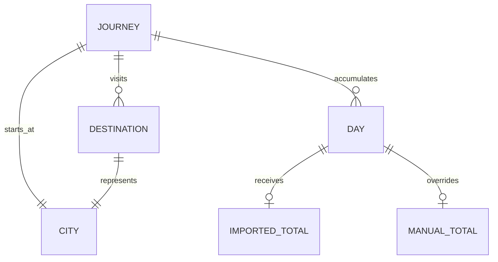
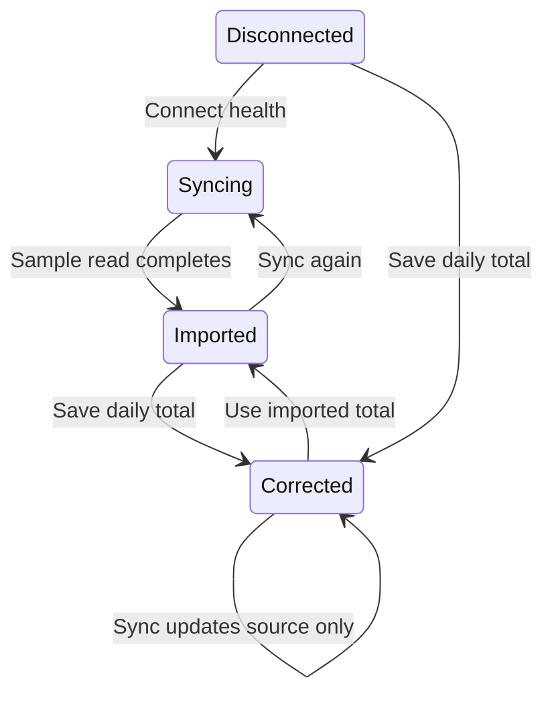

# Journey activity tracker

**Status:** The core daily experience was independently reviewed at `7dd23f8`. Subsequent increments add a city-first demo, route-specific presentation controls, populated account history, interactive country maps, and country-organized passports. Optional product choices remain explicit below.

This file is the feature's authoritative documentation. It holds requirements,
product and technical decisions, rationale, open questions, implementation status,
and validation. Keep it current alongside the code rather than creating separate
ADRs or decision registers. Linked design handoffs and skill manifests supply
supporting assets and provenance. Requirements describe intended behavior;
Implementation progress identifies what is actually delivered. Proposals and open
questions remain labeled until settled. When a decision changes, revise the
affected sections and criteria together; Git records the previous version.

## Problem

Repeated local walks accumulate distance without a lasting sense of discovery. A daily activity total provides immediate feedback, but little to collect or continue over several months. The product hypothesis is that a virtual journey through real places can make that accumulated effort more meaningful.

The daily screen will show activity advancing a journey, the next destination, and a growing passport collection. Activity arrives through a simulated health connection and can be corrected manually. The demo opens without a selected city, activity records, or collected stamps, offers manual selection or GPS, and starts the chosen route at zero. Its first successful sync populates historical activity and past stamps alongside the current reading. It waits for a tap on the sync icon before importing a route-specific reading, allowing each journey to be presented before its first arrival. Distances are available in metric and imperial units.

## Decision rationale

| Area | Decision | Reason |
| --- | --- | --- |
| Habit and retention | Walking and running distance advances travel between real cities and collects city stamps | Turn repeated local activity into visible exploration and a collection that grows over months |
| Daily interaction | Simulated health totals triggered by demo sync, plus manual replacement of a day's total | Reduce daily effort while allowing a clear correction without double-counting |
| Units | Support metric and miles, including meter entry; store integer meters | Make the interface familiar across audiences and prevent display conversions from changing progress |
| Rewards | Recalculate active-route stamps from effective distance; archive earned stamps when changing origin; track arrival announcements separately | Keep collection and progress consistent after corrections while avoiding repeated arrival dialogs on sync |
| Origin and journey | Offer browser location and city selection; suggest nearby destinations first and extend automatically | Make the journey personal without requiring itinerary planning |
| Presentation | One scrolling page with a prominent playful map, compact activity card, inline history and passport, and contextual sheets | Preserve the main daily moment on a phone while allowing deeper exploration on the same route |
| Visual identity | Cool white, deep teal, turquoise, restrained orange, miniature landmarks, and collectible stamps | Give the journey a playful, modern, gender-neutral identity with concise interface copy |
| History | Monthly day squares and a continuous GitHub-style yearly grid, using green-to-orange distance intensity | Show daily consistency and accumulated activity at two time scales |
| Architecture | Keep the scaffold, local JSON, in-memory React state, and independently testable distance rules | Keep the app small, runnable without accounts or services, and straightforward to extend live |
| Graphics | Use the finished local SVG assets; retain PNGs as design references | Preserve scalable artwork while rendering live labels and controls from application state |
| Styling | Plain CSS with shared tokens and a local font fallback | Keep visual rules explicit and avoid adding a component framework or build-time font download |
| Delivery | One feature branch and incremental commits with relevant checks | Keep each change reviewable and its behavior easy to explain |

Detailed behavior and remaining choices are specified below. These decisions do
not imply that every planned capability is already implemented.

## Shape

Reuse the existing Next.js, React, TypeScript, and local JSON scaffold. Keep distance conversion, source reconciliation, destination selection, and reward rules in pure functions that can be tested independently of rendering.

1. `data/sample.json` (exists) supplies sample activity and geographic fixtures through `lib/data.ts` (exists).
2. A health-source adapter (new) simulates an asynchronous distance import into daily activity state. Stable source/day identities prevent duplicate imports.
3. `app/components/daily-total-editor.tsx`, opened by `app/page.tsx`, edits an optional manual correction for the same day. The page dispatches it to the journey reducer; the correction replaces the imported total.
4. Browser geolocation or city selection supplies an origin. `lib/cities.ts` normalizes public city results and falls back to `data/cities.json`. `lib/places.ts` ranks nearby destinations and extends routes using city coordinates.
5. Journey calculations (new) derive accumulated meters, upcoming destinations, and earned stamps from effective daily activity and the selected origin.
6. `lib/distance.ts` formats metric/miles and converts editor values to canonical meters; `app/page.tsx` displays the journey using reusable vector assets.

New: in-memory activity, origin, destination, route offset, previous journey snapshots, and presentation state. These entities do not imply a database.

The editor offers “Use imported total” when a manual correction exists; it restores the latest source reading and closes the sheet.

| Existing surface | Change |
| --- | --- |
| Root page | Replace the scaffold with one mobile daily experience and contextual sheets |
| Sample goal data | Replace placeholder items with activity and geographic fixtures |
| Styling | Introduce a consistent teal vector visual system |
| Persisted data | No migration; persistence policy is still open |

## Surface

| Surface | Input | Output | Access |
| --- | --- | --- | --- |
| `/` | Activity source, daily correction, units, starting location | Journey, current distance, next city, collected stamps | Public; no account |
| Browser location | Explicit tap on “Use my location” | Coordinates or a manual-selection fallback | Browser permission; secure context |
| City search | City name and optional state | Named matches with coordinates | Public API with local fallback |

No application backend, authentication, payment processing, or native health SDK is introduced.

### One-page composition

Use one route, `/`, implemented through `app/page.tsx`, with vertical scrolling.
The default order is journey map/next city, today's activity, activity history,
then a compact passport preview that expands inline. The Month / Year switch
replaces the history content in place. City selection and daily correction use
contextual bottom sheets; arrival uses a transient overlay on the same page.
The yearly grid follows the page vertically without an internal scroll container. No separate history,
passport, settings, or onboarding routes are required.

The static boards depict states of this page, not additional routes. The existing
full-page artwork places the passport before history; use the composition above
when implementing. The asset handoff’s Runtime comparison records the implemented order and the differences from the original studies.

## Technical decisions

### Distance and activity

- Store canonical distance in integer meters. Convert decimal miles once at entry using 1 mile = 1,609.344 meters; round only when accepting the physical value.
- The selected calendar date can be edited through the same sheet as today. The editor names that date, uses the selected unit, and offers source restoration only for a date with a simulated import. Past-day corrections apply their net change to current-route progress, including activity predating the selected journey; archived reward snapshots remain retained. Changing the starting city still resets its route to zero. Future dates are viewable but not editable.
- Effective daily distance is `manualOverrideMeters ?? importedMeters ?? 0`. Zero is a valid correction.
- Merge imports by source/day identity. Re-reading an identical source record cannot add distance or repeat an arrival.
- Keep the imported value when a manual override exists. A later import must not silently remove the correction.
- Formatting never writes back into stored distance. Repeated unit switches and unchanged saves must not introduce rounding drift.
- Before city selection, the active route is an empty array and no country is marked Current. The account starts without records or collected stamps. Both supplied journey fixtures become historical snapshots only on the first valid demo sync: the completed Brazil route and the prior 10km Washington route. Their activity then remains shared with history and lifetime distance. The start panel offers explicit city selection or GPS, with a bounded failure message and manual fallback. An empty route cannot receive demo imports or invent new stamps.
- A chosen city receives an automatically determined itinerary from real nearby unvisited places; destinations are not user-selectable. `demoReadingForJourney` prepares one absolute daily reading when the route starts: previous imported total plus distance to its first checkpoint and a small remainder below the next checkpoint. The asynchronous adapter returns that frozen reading on explicit sync. This is deliberate presentation data, not a measured daily health value; longer city legs may produce large demo totals. Ordinary imports still replace a day’s source value, and manual overrides remain authoritative. Changing the origin invalidates any pending reading; repeat syncs do not generate further walking.
- The habit is walking and running distance. Health integration is a local simulation identified by a compact “Demo” label. After the sync icon is tapped, it updates the journey without a manual distance entry or second save. Loading the page alone does not request the demo reading.
- Active-route stamps are recalculated from corrected accumulated distance. Stamps archived by an origin change remain collected. Arrival announcements are tracked separately so an identical re-sync cannot replay them.
- The current default is metric, matching the existing design and first slice. Summaries show kilometers or miles to one decimal at most; metric editing uses whole meters, while miles editing shows up to three decimal places. The unit selection is in memory and affects presentation only.
- The editor captures its starting value. Saving an unchanged displayed value, including equivalent numeric formatting, preserves the original integer meters instead of converting the rounded display back. A changed value is converted and rounded once on save. Empty, negative, non-numeric, fractional-meter, and unsafe-size entries remain unsaved with a short inline error.
- Saving or restoring an imported total closes the sheet; cancel, close, backdrop dismissal, and Escape discard the draft. “Use imported total” is available when a manual correction exists and restores the latest imported reading. Imports may update their source record while the sheet is open but do not rewrite its draft. Pending arrival notices for cities no longer reached are removed after a downward correction.

### Origin and city discovery

- Use `navigator.geolocation.getCurrentPosition` on an explicit gesture for starting-location coordinates. This requires no paid service or API key; the browser requests permission and uses its available location providers.
- Location establishes an origin; it does not record the person's walking route or measure daily activity. Health data and manual totals supply that distance.
- Offer manual city search independently of location permission. A location denial or timeout keeps the picker usable. Simulation, when needed for a demo, is explicitly marked rather than presented as a measured location.
- Photon replaces the initial Open-Meteo proposal because it supplies both city search and nearby place lookup through one no-key service. Use explicit search submissions rather than network requests on every keystroke. Its public demo permits reasonable project use without an availability guarantee; keep requests bounded and retain a local fallback. No self-hosted geocoder is introduced.
- Search uses Photon's city-layer forward endpoint. Nearby discovery uses its coordinate-based reverse endpoint, requesting up to twenty settlements within 100km. Normalize named cities/towns with valid point coordinates; US incorporated villages may also qualify after registry validation. Brazilian results must additionally match a municipality name and state in the bundled IBGE registry, including Brasília as the federal capital; DF administrative regions and other unrecognized submunicipal places are rejected even when Photon tags them as city/town. US results additionally match a Census municipality registry; other countries retain the provider city/town filter, rather than claiming a worldwide municipal registry. Time out requests after four seconds and abort obsolete searches or closed-sheet requests. Location permission denial leaves city selection usable.
- `data/cities.json` bundles 62 sample municipalities around Washington, New York, Boston, Seattle, San Francisco, and Brasília/Goiânia, including a longer New York corridor. Brazilian state aliases normalize to DF/GO, and saved Brasília/Goiânia choices are available without a city-service response. OSM-derived data is credited to OpenStreetMap/Photon; the original DC corridor uses Census coordinates. This is a demonstration fallback, not a comprehensive global city catalog.
- `data/brazil-municipalities.json` contains 5,571 name/state records from IBGE’s public municipality endpoint, retrieved 2026-11-23 (including its Brasília/Fernando de Noronha statistical entries). It is an eligibility index, not a route/coordinate source: no destinations are invented from names. Match accent-insensitively while retaining state identity; Cruzeiro, SP is distinct from Cruzeiro, DF. The 124kB snapshot adds no runtime API request and works offline. Refresh it from the recorded source when municipality names change. Ambiguous/unrecognized Brazilian city names are omitted; saved nearby municipalities remain the fallback.
- `data/us-municipalities.json` retains 25,486 unique name/state entries from the 2026 Census places and county-subdivision Gazetteers, retrieved 2026-11-23. Include FUNCSTAT A/B/C places and general-purpose municipal towns/townships in the twelve Census MCD states; retain Washington, DC as the federal-capital legal entity and short aliases for Massachusetts Town-city names. Exclude statistical CDPs and subordinate/nonfunctioning subdivisions. For 894 ambiguous name/state combinations, 1,897 Census reference points distinguish eligible municipalities from unrelated CDPs by proximity; municipality references win exact ties (coextensive municipal towns). This is a conservative reference-point check, not polygon containment. The 750kB bundled eligibility index adds no runtime request or destinations. White Center, WA and the Westchester Greenville, NY CDP are removed from the saved catalog.
- Use the city name, state, and country to distinguish duplicate names. Normalize external results behind one adapter. Do not treat a text-search endpoint as a radius/nearby-city service.
- Prefer unvisited eligible cities in the current state, choosing the nearest from each stop. Only after the available state catalog is exhausted may the route cross to the nearest eligible city in another state. Do not return to states already departed within the active itinerary. Exclude visited identities and foreign-country candidates, and retain the existing route prefix. Completion covers available catalog cities, not a claim of comprehensive statewide coverage. If known in-state cities remain beyond the 250km leg bound, wait for closer connecting candidates rather than bypassing them with a border crossing. Capitals do not receive routing priority over a closer ordinary city. Maintain two upcoming destinations for initial planning; each settled map movement may append up to six destinations to the preserved itinerary, without a fixed total lookahead cap. Use great-circle distances rounded once per segment, with candidate legs between 1km and 250km. The minimum avoids effectively colocated stops; the maximum prevents a sparse fallback from silently suggesting a cross-country jump. These are demo bounds, not road distances or a walking-navigation service.
- Fetch additional candidates near the last known stop on settled map movements as well as when fewer than two upcoming destinations remain. Candidate exhaustion leaves existing progress intact and keeps city selection available; no invented coordinates or city names fill gaps. Normalize city/state/country identity and provider aliases so known places keep their original artwork and coordinates.
- Geolocation supplies coordinates, not a city name. Resolve the name from a sufficiently complete local city catalog, or leave it as “Current location” and offer city selection. Do not label a far-away catalog entry as the detected city. The example map is not a fixed origin or itinerary.
- Choosing a different starting city starts a new route at zero. Preserve all daily records, manual overrides, previous journey snapshots, and already collected stamps (including origins); no prior distance transfers into the new route. Selecting the same city is a no-op. This supersedes the earlier checkpoint-remainder policy recorded in historical slice validation.
- Store a route offset in meters: active distance is `max(0, effective lifetime distance - route offset)`. On an origin change, set the offset to effective lifetime distance. The map badge shows active journey distance; its caption shows lifetime distance separately. Corrections continue to change daily history and active progress; previously archived stamps stay collected. A correction below the offset clamps active distance to zero; later activity first covers that difference.
- Archive the departing route and its effective distance before replacement. Exclude archived collected cities from future destination candidates and deduplicate passport stamps by normalized place identity. Reject a proposed origin without enough genuine nearby candidates to render its route, leaving the existing journey intact.

### Visual system and content

- Palette: cool white, deep teal, turquoise, and restrained orange accents. The current proposal's tokens are in `design/journey/game/tokens.json`.
- The journey map and passport collection are the primary visual features. The game-inspired presentation keeps miniature city symbols and collectible stamps around an interactive geographic map with an orange progress marker. Keep the contemporary travel character and concise mobile controls.
- The map uses real geography through Leaflet 1.9.4, with direct OpenStreetMap street tiles and bundled Natural Earth country outlines for US/BR. Dragging, pinch zoom, keyboard controls, explicit 44px zoom buttons, country framing, and return-to-route framing keep exploration on the same page. Street tiles require no key; five seconds without a loaded tile or a tile error exposes an offline-outline status while local geometry and route controls remain available. Visible OSM/Natural Earth credit stays on the map. No tile prefetch, offline tile download, proxy, or new backend is introduced; normal browser caching and referrers are retained. Public OSM tile availability is not guaranteed; production-scale use would need a suitable provider.
- City markers use city-center coordinates and safe DOM text for names/popups. Display segments join real cities with straight virtual lines; distance thresholds still use rounded great-circle meters. The orange progress point interpolates within the current segment and does not represent measured GPS activity or a road route. Country-scale views replace overlapping city art/labels with small pins; route framing restores the detailed symbols. The US country view frames the contiguous states; Alaska and Hawaii remain browsable. No XP, currency, or streak mechanics are implied.
- Keep the default screen free of explanatory paragraphs. Prefer section headings of up to three words and button labels of up to four words. Keep necessary explanations in contextual sheets or project documentation.
- Sheets dismiss on taps outside their actual bounds, not on their own padding. The mobile viewport requests content resizing for the on-screen keyboard, while retaining normal zoom. Inputs advertise Search/Done keyboard actions. The origin control wraps long labels and exposes its current city as an accessible description.
- Calendar day text uses a stronger dark teal to maintain contrast on the highest orange distance band. Colors still derive from the same period intensity calculation.
- Icon-only controls retain accessible names and 44px interaction areas. An icon's drawing size is not its touch-target size.
- Use familiar sheets for city selection and manual correction. Retain only short explanatory copy where it prevents a material mistake, such as “Replaces the imported total.”
- Use local SVGs for reusable artwork. Origin, route points, city labels, and live progress remain data-driven. The supplied geographic route is a visual fixture, not the production map for every city.
- City-specific motifs are available for the sample collection, with neutral city, harbor, and mountain motifs for extension. Never associate a specific landmark illustration with an unrelated city.
- Stamps include earned and future variants. Collected map landmarks and their compact-dot variants carry a small orange check; their accessible names expose collected status. Future markers have no check. Future artwork and frames use 40% opacity and reduced saturation, while city/status captions remain fully readable; earned stamps retain full color. Long city names need readable wrapping or an adjacent HTML label, not arbitrarily shrinking text.
- Map lines render the full known itinerary, including later stops revealed through discovery. Every route place has a standalone illustration with a warm radial gradient fading to transparent behind it at local zoom; overlapping lower-priority icons collapse to dots until more screen space is available. The next stop has a larger illustration, a coral-orange halo, and a permanent label; capitals retain a gold halo and seal. Landmark backgrounds have no frames, borders, or solid panels. At country zoom, icons collapse to compact dots with the next stop distinguished. All places retain popup names/status/distance. Street tiles render at 30% opacity over a dark teal base, with a pale mint dashed itinerary and a turquoise completed path above it. The three-stop route window controls framing rather than limiting the rendered itinerary. Panning/zooming is preserved on ordinary distance updates; changing the origin or visible route window reframes the route. Mouse wheel zoom is off to preserve page scrolling, while pinch, keyboard, and buttons zoom the map. ResizeObserver updates the viewport without recreating the map. The browser-only library loads inside an effect and removes its listeners/map on cleanup, keeping server rendering safe. Known sample cities reuse their original motifs; other places use the generic skyline. Runtime stamp frames compose the existing motif with the actual city label and earned state, avoiding static sample text for unrelated places.

### Passport and arrivals

- Keep the passport preview to at most three unique places: the current origin, latest collected destination other than that origin, then upcoming stops. Before any arrival, upcoming places fill the available slots. When no future destination is available, other collected stamps fill the preview. The count represents distinct destination arrivals, excluding origin-only stamps and upcoming places.
- A native inline disclosure reveals remaining stamps, with separate “More collected” and “Next discoveries” groups where needed. Do not repeat stamps already in the preview. Keep the control absent when everything is already visible. Disclosure changes only presentation; the reducer remains the source of earned and archived rewards.
- The page derives country passport models in `lib/passport.ts` from the current route, corrected activity, and archived journeys. A country filter applies to collected/future stamps and arrival counts. A foreign country previews its most recent archived origin and collected destinations; it never borrows stamps from the current route’s country. The arrival overlay uses the current country’s destination count.
- The starting city remains the only control that changes the active journey/country. Country identity uses a known code or the bundled outlines for coordinate-only GPS origins. Inside the passport, a rounded country dropdown selects which collection to browse; the active journey’s country has a Current suffix. Options derive from actual collected and planned countries, allowing the list to grow without adding horizontal controls. An account without any country collection shows a concise empty passport message. Each view has a country heading and its own arrival count. Its three-stamp preview and inline disclosure remain independent of map exploration and the shared activity calendar. Passport UI state resets to the current country when the starting city changes; browsing stamps never dispatches a journey action. Collapsing the collection does not change progress, rewards, or the history view.
- National and state capitals share a higher visual stamp tier: a warm gold/orange illustration panel, gold double frame, star seal, and visible Capital label. Ordinary cities keep the standard teal stamp with no special tier emblem. Future capital stamps use subdued colors and faded artwork; they remain unearned until their actual distance threshold is reached. The capital classification changes presentation only, preserving Origin/Collected/Up next semantics, arrival counts, correction rules, and archived rewards. Capital map symbols have the same star seal; capital next-stop and arrival headings use “Capital milestone”.
- `data/capitals.json` holds factual name/state/country identities for 50 US state capitals, 26 Brazilian state capitals, and the two national capitals. `capitalKind` matches all three identity fields and documented aliases; New York and Seattle remain ordinary cities. The registry also supplies state-name normalization/search with country-aware region lookup (e.g. MA in Brazil vs the US). Unknown places remain standard; capital status is never inferred from population, landmark art, or a provider’s unverified status flag. Source links are retained with the data and asset handoff; no coordinates or route stops are added by this registry.
- Keep the existing stamp motifs, perforated frames, and explicit Origin/Collected/Up next labels. Allow two caption lines at the same readable size, extending the frame to avoid artwork overlap. Preserve full place names in accessible labels and native name tooltips. Unknown cities keep the generic skyline.
- Arrival uses the existing brief stamp animation and restrained orange/turquoise sparks. A native modal shows the actual city and next destination, focuses “Continue journey,” contains Tab focus, and supports Escape. On dismissal, restore the previous connected control, falling back to the health-sync button when the previous control is unavailable. Queued arrivals are shown in route order once; corrections remove notices no longer earned. Reduced motion shows the final stamp immediately. No XP, reward currency, or separate passport route is introduced.

### Activity history

- Add a monthly calendar after today's activity and before the passport, with one square per calendar day. A Month / Year switch offers a GitHub-style contribution grid: seven weekday columns and continuous week rows, with month labels down the left. The year never restarts into separate monthly calendars. The full grid follows ordinary vertical page scrolling; no sideways gesture or internal scrollbar is required.
- The proposed six-band scale goes from pale green through yellow-green and amber to orange: `#C9E9D9`, `#9ED5BA`, `#CFDF95`, `#EDCD7B`, `#EF9A59`, `#E87C3B`. Use equal distance bands from zero to the maximum effective daily meters in the displayed month or year; one scale applies throughout the displayed period. A revised maximum may recolor the period. Unit switching cannot recolor it. This is distance intensity, not goal completion.
- Confirmed zero is neutral; future dates are outlined. Missing records remain unrecorded, not inferred zero. Guard periods with no positive values against division by zero. Use a short Less / More key and a selected-day date/distance readout.
- Keep day numbers and a selected outline. Monthly squares expose date and distance through accessible names and keyboard navigation. The yearly grid uses roving keyboard focus and arrow-key date selection with an exact date/distance readout. Keep a monthly view for precise touch selection; do not assign overlapping 44px targets to densely packed yearly cells. Use a seven-column roving-focus calendar on narrow screens rather than making the page wider.
- Year view uses continuous Monday-first week rows with padding only outside January 1–December 31. Month labels sit beside the week containing their first day, with weekdays across the top. History initially selects yesterday relative to the shared demo clock; subsequent day selection and Month/Year switching retain the chosen date. Switching views does not programmatically scroll the page.
- Year keyboard arrows follow the visible grid: left/right move one day, up/down seven days. Home/End select the same week’s Monday/Sunday; Page Up/Down move one year, clamping leap days. Crossing a year boundary updates the displayed year and keeps focus on the selected date. Year arrows in the header preserve the selected month/day where possible. Dense year squares retain precise accessible names; the monthly calendar provides large touch targets.
- Monthly navigation follows the Monday-first design. Arrow keys move one day or week, Home/End move to the week boundaries, and Page Up/Down move months. Month changes preserve the day number where possible and clamp it for shorter months. Selection moves with the displayed month; future and unrecorded dates remain selectable for their status readout. Only one day is in the Tab sequence.
- Group records by the same local calendar dates as the daily editor, respecting the configured timezone, real month lengths, weekday offsets, and leap years. Do not derive local dates by slicing UTC timestamps.
- All runtime history, daily totals, and journey calculations use the same effective activity records, including corrections and valid zero values. `data/sample.json` supplies the single runtime account; the monthly calendar reads reducer state directly. The separate history design fixture illustrates a longer account and is reference-only: its distances are not loaded as a second activity source. The runtime starts with no records. The first successful demo sync loads the historical fixture into this same reducer; until then, dates remain unrecorded.
- Date-only values already identify the local calendar day in the configured account timezone. Use UTC noon solely for date arithmetic and explicit UTC formatting of those date-only values; do not reinterpret activity dates using the browser timezone. The demo clock remains `sample.today`, matching its health reading and fixtures.
- The continuous contribution-grid layout follows the requested yearly direction. Scale and interaction details remain review proposals. Numeric streaks, missed-day penalties, and monthly goals remain separate product choices.
- Grand discoveries adds distinct state/district rosettes and a country medallion after the city collection. State completion requires every eligible municipality in the full bundled IBGE/Census registry, not the currently loaded map candidates. Starting cities count. Country completion requires every state and federal district: 27 Brazilian regions or 51 US regions including DC. Districts use a District label; other regions use State. Region names come from the capital identity registry.
- `lib/completion.ts` builds canonical registry identities once, then derives completion from unique collected city stamps across active and archived journeys. Massachusetts Town-city aliases count as one municipality. Invalid names/CDPs and duplicate visits cannot inflate progress. The snapshot version is 2026-11-23. There is no separate persisted badge store: active corrections can revoke completion, while archived stamps continue to count. Unsupported countries do not claim completion.
- Hawaii remains unsupported: the place registry contains no incorporated municipalities there. Keep Hawaii as an explicitly unsupported, unearned region in the 51-region denominator, and keep US country completion locked. Do not silently exclude it, award a zero-city state, or treat a Honolulu CDP as a municipality. The passport identifies Hawaii as not yet supported. Census distinguishes the combined City and County of Honolulu in government statistics from the statistical place layer; extending that policy is deferred. Source: [Census Hawaii geography guide](https://www.census.gov/geographies/reference-files/2010/geo/state-local-geo-guides-2010/hawaii.html).
- Show the selected origin’s region challenge, all earned region badges in that country, and its country challenge with numeric progress. Future badges are subdued; earned ones show full gold/teal artwork. Use original local `state-complete.svg` and `country-complete.svg` assets. No additional reward currency or navigation screen is introduced.
- Newly earned completion badges share the city celebration dialog, focus restoration, reduced-motion behavior, and viewport confetti. City arrivals are shown first, then completion rewards. Record announcement identities separately to avoid replay on sync or correction/recovery. Historical demo backfill exposes past completion without replaying its notice. A starting city may immediately earn its district reward without importing activity, including Brasília or Washington.

## Landing

No persisted schema, production contract, or paid dependency is added. The geocoding service sits behind a replaceable client adapter. The sample route, asset styling, component decomposition, and in-memory data types remain reversible.

External assets and data require provenance. The local SVG artwork is original project artwork; the independent Canva study is a design reference, not a stock-asset license or a runtime dependency.

## Criteria

### S1: View an automatically advancing journey

1. WHEN the simulated health source returns activity THEN the screen SHALL update the daily total and journey without requiring a manual save.
2. WHEN an identical source/day record is imported again THEN the accumulated meters SHALL remain unchanged.
3. WHEN effective cumulative distance crosses a destination threshold THEN the screen SHALL display the arrival and its stamp.
4. WHILE the connection is simulated THEN the source status SHALL include “Demo”.

### S2: Change units and correct activity

5. WHEN the unit selector changes THEN every distance label SHALL use the selected system without changing stored meters, progress, targets, or rewards.
6. WHEN a manual daily total is saved THEN it SHALL replace that day's imported total in journey calculations.
7. WHILE a manual correction exists THEN subsequent imports SHALL preserve the correction as the effective daily value.
8. IF the correction is zero THEN the effective value SHALL be zero rather than the imported value.
9. WHEN editing is canceled THEN saved distance SHALL remain unchanged.
10. WHEN an unchanged formatted value is saved THEN the original physical distance SHALL be preserved.

### S3: Start locally and continue to nearby cities

11. WHEN “Use my location” is activated THEN the application SHALL request browser location permission and show a usable origin or a city-selection fallback.
12. WHEN a city-search result is selected THEN the journey SHALL use that city's normalized coordinates as its origin.
13. IF city lookup fails or times out THEN the picker SHALL offer local sample cities without blocking the rest of the screen.
14. WHEN a next destination is needed THEN the application SHALL suggest a nearby unvisited candidate and extend the journey automatically.
15. WHILE named location data is unavailable THEN the application SHALL avoid presenting an unrelated city as the detected location.
28. WHEN a different starting city is chosen THEN the application SHALL preserve activity history and collected stamps, start its new route at zero with no destination arrival overlay (a newly completed district may celebrate), and add only subsequent activity once.

### S4: Deliver the reviewed mobile experience

16. The screen SHALL work at 360px and 390px viewport widths without horizontal page scrolling.
17. The map, next destination, accumulated distance, daily activity, and passport SHALL remain readable without explanatory paragraphs.
18. WHEN reduced motion is enabled THEN arrival and progress updates SHALL remain understandable without animation.
19. WHEN an icon control receives keyboard focus THEN it SHALL have a visible focus treatment and an accessible name.
20. The reusable graphics SHALL be present locally before application implementation begins.

### S5: Explore monthly and yearly activity history

21. WHEN a month is displayed THEN it SHALL contain one correctly positioned square per actual calendar day, including leap days.
22. WHEN effective daily distance changes THEN history, selected-day distance, and journey SHALL reflect the same corrected record without adding imported distance again.
23. WHEN units change THEN history labels SHALL convert without changing stored meters or color bands.
24. WHEN a period has positive activity THEN higher daily distances SHALL occupy progressively higher bands on one shared green-to-orange scale for that period.
25. WHEN a monthly day is selected THEN its date and distance or unrecorded/future status SHALL be available without relying on color.
26. WHEN Year is selected THEN a continuous contribution grid SHALL arrange days in seven weekday columns and continuous week rows, with month labels down the left and ordinary vertical page scrolling; selected dates SHALL expose their distance through the readout.
27. WHILE a day is future or unrecorded THEN it SHALL NOT appear as confirmed zero activity.

### Presentation control

32. WHEN a route is chosen THEN its first demo sync SHALL import enough new activity to reach that route’s first destination without reaching the second; repeated sync SHALL reuse the frozen daily reading without adding distance or replaying that arrival. A reading requested for an abandoned route SHALL NOT update its replacement. Manual overrides SHALL still take precedence.

### Populated account and country maps

33. WHEN the first valid demo sync completes THEN August–November activity SHALL populate the same daily records used by the calendar and lifetime total, including recorded rest days and occasional unrecorded dates. The completed Brazil journey SHALL account for that older distance and supply previously collected stamps without arrival overlays.
34. WHEN a US or Brazilian starting city is selected THEN the map SHALL show its geographic location and route, allow dragging and zooming, and offer country and route framing. Map-service failure SHALL retain local country outlines, route markers, distance, and city selection. The map SHALL NOT measure activity or imply road navigation.

35. WHEN a starting city is selected THEN its country SHALL determine the current journey and map. The passport SHALL separate stamps and destination counts by country, default to the current country, and allow browsing another country without changing the route or activity. Month/Year history SHALL remain shared across countries. Changing the starting city SHALL return the passport to that city’s country.

36. WHEN the page first opens or refreshes THEN no starting city or active country SHALL be selected; the page SHALL offer city selection and browser location, start with no recorded activity or collected stamps, and disable health sync until a usable route is chosen. A denied/obsolete location request SHALL leave manual selection available and SHALL NOT override a subsequently chosen city.

37. WHEN a route is extended THEN each next stop SHALL be the nearest available unvisited eligible city in the current state. Only after exhausting that state’s available catalog SHALL the route cross to the nearest eligible city in another state of the same country. Previously departed states SHALL NOT be reentered, and the route prefix SHALL remain stable. Capital status SHALL NOT change this ordering.
38. WHEN a national or state capital stamp is shown THEN it SHALL carry a distinct brighter milestone tier with a non-color Capital label and emblem. Future and earned capital stamps SHALL remain distinguishable, and capital arrivals SHALL use the milestone heading without changing distance or reward rules.

39. WHEN the passport contains country collections THEN a rounded dropdown with spaced touch targets SHALL list those countries, identify the current journey country, and switch only the displayed collection. It SHALL remain usable as more countries are added. Before any country collection exists, the passport SHALL show no stamps or invented country options. Its options SHALL support touch selection, arrow keys, Home/End, letter navigation, Enter/Space selection, Escape, outside dismissal, and visible focus.

40. WHEN a starting city is first chosen THEN its journey SHALL start at zero with no historical records or destination stamps. WHEN its first valid sync completes THEN the account SHALL load past activity and country stamps exactly once, preserving manual corrections and excluding historical distance from active-route progress. Later syncs and city changes SHALL retain that history without duplicating it; refresh SHALL reset the demonstration. An abandoned first-sync request SHALL NOT populate history. The selected starting city may appear as an Origin stamp before any destination is reached.

41. WHEN history first renders THEN yesterday relative to the shared demo clock SHALL be selected. Subsequent date selection SHALL remain available and persist across Month/Year switching. Year SHALL show seven weekday columns and continuous week rows in the ordinary vertical page flow, with no internal horizontal scrolling; keyboard arrows SHALL follow that orientation.

42. WHEN the start panel appears THEN its illustration SHALL have subtle, finite motion. Choosing a city SHALL fade in the map view; changing Month/Year SHALL fade in the replacement grid while retaining date selection. Stamp arrivals SHALL animate the dialog, backdrop, stamp, and accents, and fade out before dismissal. Reduced-motion preferences SHALL disable these animations and dismiss immediately; animations SHALL NOT alter activity or reward calculations.

43. WHEN units or history view change THEN both switches SHALL render the same reusable controlled segmented component, with a sliding selected pill, unchanged accessible button names/pressed states, and targets of at least 44px. Reduced motion SHALL remove its transitions. Unit changes SHALL affect display only; history switching SHALL preserve the selected date.

44. WHEN Brazilian city results are normalized for search or nearby routing THEN they SHALL match both name and state in the bundled IBGE municipality registry. Brasília SHALL remain eligible while DF administrative regions such as Sudoeste e Octogonal and Cruzeiro SHALL NOT become origin choices or journey destinations. Valid same-name municipalities in other states and existing offline city fallback SHALL remain usable. Provider suburb/neighborhood features SHALL remain excluded for all countries.

45. WHEN US settlements are normalized for search or nearby discovery THEN they SHALL match the Census municipal eligibility registry, retaining incorporated cities/towns/villages and qualifying municipal towns/townships while excluding neighborhoods and unincorporated CDPs. Ambiguous same-state names SHALL use reference coordinates to distinguish a municipality from a different CDP. Saved candidates SHALL obey the same policy. Washington, DC SHALL remain available as the federal capital.

46. WHEN an upcoming route city marker or its label is tapped THEN its popup SHALL show remaining virtual itinerary distance in kilometers, calculated from the city checkpoint minus current journey progress. Collected/origin places SHALL retain their status without a positive remaining-distance claim.

47. WHEN the journey map finishes panning or zooming THEN eligible discovered cities SHALL feed the automatic itinerary planner, appending up to six stops per settled movement under the same state/country/visit/distance rules, without a fixed total itinerary cap. Each movement SHALL also discover candidates around the last planned stop, including when viewport results are cached. The map SHALL connect all planned cities with route lines. Discovery SHALL NOT reorder existing legs, change distance already walked, or grant stamps for merely previewed destinations. Every upcoming route popup SHALL show cumulative itinerary kilometers remaining. At local zoom, stops SHALL use frameless illustrations with warm opaque-to-transparent halos, collapsing overlapping lower-priority icons to dots; the next stop SHALL be larger and permanently labeled. Capital halos SHALL retain a warm gold tone. At country zoom, icons SHALL collapse to compact dots. Street detail SHALL blend into dark teal beneath bright route lines and markers. Public lookups SHALL remain debounced, bounded, cached, and cancellable, with local fallback. Only successful viewport responses SHALL be cached; local fallback after failure SHALL remain retryable when that area is revisited. Pending city requests SHALL show a pointer-free loading status that clears on completion, cancellation, or failure and respects reduced motion.

48. WHEN a new stamp arrival opens THEN a brief, non-looping teal/orange/gold confetti burst SHALL span the full visible viewport above the arrival modal to celebrate it without intercepting interaction or replaying on repeated sync. Reduced-motion preferences SHALL hide the confetti while retaining the static stamp and controls. Browsers without Popover support SHALL retain the functional modal with the decorative overlay hidden.

49. WHEN viewport space permits THEN the single page SHALL adapt beyond its phone layout: tablet content SHALL expand, and wide screens SHALL place journey/start content beside activity, history, and passport. The journey SHALL remain available while scrolling the desktop activity column. Phone order, readable target sizes, map resizing, and absence of horizontal page overflow SHALL be preserved.

50. WHEN a past or current date is selected in Month/Year THEN the distance readout SHALL offer an edit control opening the shared date-aware distance editor. Saved corrections SHALL replace that day’s total and adjust shared history, lifetime distance, active-route progress, and active stamps; they SHALL NOT overwrite today’s independent record or revoke archived stamps. Future dates SHALL NOT offer editing. Available imported values SHALL be restorable, including after a pre-sync correction; manual-only dates SHALL NOT claim an imported source.

51. WHEN a state/district has every eligible municipality collected across journeys, including the starting city, THEN it SHALL earn a distinct completion badge. Partial API/map coverage SHALL NOT be used as the denominator. Corrections SHALL recalculate active completion while archived collected stamps remain valid.
52. WHEN all registered states/districts are complete THEN the country SHALL earn its distinct badge. Missing or unsupported registry coverage SHALL keep it locked; Hawaii SHALL remain unsupported in the US denominator until an explicit eligibility extension.
53. WHEN a completion reward is newly earned THEN it SHALL celebrate once through the shared accessible arrival dialog. Historical backfill and repeated sync SHALL NOT replay old completion rewards; reduced motion and missing Popover support SHALL retain functional controls.

### S6: Browse the passport and celebrate arrivals

29. WHEN the passport is collapsed THEN it SHALL show at most three unique stamps, and an inline disclosure SHALL expose remaining collected and known upcoming stamps without navigation or duplicates.
30. WHEN distance or origin changes THEN the collection and destination count SHALL follow active correction and archived-stamp retention rules, excluding origin-only and future stamps from the arrival count.
31. WHEN multiple destinations are newly reached THEN arrival notices SHALL appear in route order once, with focus contained in each modal and restored to a connected page control after dismissal.

## Design artifacts

These static design studies document the visual direction. The implementation and browser comparisons are recorded below; the studies are not a live application prototype.

- [Current screen board](../design/journey/game/design-board.png): playful journey, arrival, and daily correction.
- [Complete Canva review set](https://www.canva.com/d/wfBbyy10pavjL25): fourteen imported screens/boards with native text and illustration elements; local SVGs remain the geometry source. Import rendering still needs visual review.
- [Current asset board](../design/journey/game/asset-board.png): dimensional landmarks, collectible stamps, and palette.
- [Activity history board](../design/journey/game/history-board.png): monthly day squares and proposed yearly overview.
- [Full daily page](../design/journey/game/screen-journey-full.png): scroll continuation of the collection.
- [Current asset handoff](../design/journey/game/README.md): file inventory, reuse rules, and provenance; includes city-picker and health states.
- [Earlier travel-journal study](../design/journey/README.md): retained for comparison.
- [Canva portrait study](https://canva.link/15830ispzmw7buz): editable exploration; the local SVG screens provide the exact 390px mockups.

## Delivery and validation

Use the single branch `feat/habit-tracker-home`. Implement one observable vertical
slice at a time, checking and committing each before the next. Keep behavior and
its relevant tests together. If a slice becomes too large, split it at a coherent
working behavior boundary. Do not add co-author trailers.

| Commit | Scope and reviewable outcome | Validation |
| --- | --- | --- |
| `chore: add project skills and development guidance` | Three complete local skills, pinned provenance, licenses, and agent rules | Verify file hashes, attribution, and staged changes |
| `docs: define journey experience and visual assets` | Neutral technical spec, current game-map graphics, stamps, icons, calendar/contribution-grid studies, and asset handoff | Resolve local links; parse and visually inspect SVGs; distinguish current references from earlier studies |
| `feat: add daily journey with simulated health sync` | One-page journey and today's total, local sample data, automatic simulated import, destination arrival and stamp preview | Test source/day deduplication, distance thresholds, and arrival replay; use the page at phone size |
| `feat: add units and daily distance correction` | Metric/miles control, meter entry, replacement correction, and return to imported value | Test zero overrides, import preservation, rounding, unchanged saves, and visible labels |
| `feat: add starting city and nearby destinations` | Explicit browser location, city picker/search with local fallback, automatic nearby route extension | Test candidate identity/order, unavailable API fallback, and the agreed origin-change policy |
| `feat: add monthly activity calendar` | Daily squares, green-to-orange distance scale, period navigation, exact selected-day readout, shared activity records | Test month boundaries, leap years, unknown versus zero, corrections, and unit-invariant colors |
| `feat: add yearly activity contribution grid` | Continuous week columns and seven day rows, month labels, internal horizontal scroll, date selection | Test date placement across year boundaries; use keyboard and touch navigation at phone width |
| `feat: complete passport collection interactions` | Expandable inline collection and reviewed arrival presentation using the original assets | Verify stamp counts, the agreed correction/retention rule, long names, and reduced motion |
| `fix: refine mobile layout and accessibility` | Measured visual refinements, final section order, focus and sheet behavior; resolve review findings | Run required lint/build/tests and inspect the complete experience in a browser |

The first journey slice includes the initial stamp and arrival behavior; the later
passport slice completes browsing and visual polish rather than deferring the
reward rules. If review finds no fixes, omit an empty final fix commit.
Commit descriptions explain technical changes and validation.

For every implementation commit, provide a plain-language explanation of the
change, its purpose, the data flow, the checks run, and its principal tradeoff.
Keep code small and direct enough for a live extension. Maintain concise setup
and architecture guidance in the repository documentation.

The repository carries [three project-local skills](skills.md), including source revision and attribution. The current work uses TLC's planning structure and frontend-design guidance; the best-practices skill is available for implementation. Installation does not constitute a completed audit or an approved build plan.

### Implementation progress

**Review:** pass at `7dd23f8`; no actionable implementation defects found. The independent check covered the original requests, all 31 criteria, rule-test sensitivity, capture-size comparisons, and isolated browser interactions.

**Fix pass:** done — no application changes required. Review outcomes and additional compatibility verification are recorded below.

- Foundation: `f78bba9` records the skills, design assets, and technical guidance together before application implementation.
- S1: `5904704` implements the page with original landmark/scenery SVGs, live route progress, daily distance, and stamp states. A local asynchronous health adapter imports a daily total; the initial automatic trigger was subsequently replaced by the presentation control below. Pure functions in `lib/journey.ts` calculate distance and arrivals; a reducer prevents duplicate imports and arrival replay. `lib/data.ts` loads the local JSON fixture.
- Styling uses plain CSS with shared tokens. The unused Tailwind CSS loader was removed from `next.config.ts`; no component framework or new runtime dependency was added. The font stack uses Ubuntu Sans when available and local sans-serif fallbacks, avoiding a build-time font download.
- Verification for S1: five rule tests pass, ESLint passes, production build passes, and the running page was exercised at 360px, 390px, and 1024px. Browser checks cover automatic import, new-city arrival, unchanged re-sync, Escape dismissal, reduced motion, and absence of page runtime errors. Subsequent slices and the completed independent review are recorded below.
- S2: the header switches metric/miles throughout the page. A native-dialog bottom sheet edits today's distance, with imported-value context, replacement correction, and restoration of the imported value. Draft state belongs to the sheet; saved activity belongs to the reducer. Corrections and imports share the same arrival reconciliation, so stamps and progress recalculate together.
- Verification for S2: all twelve rule tests pass, ESLint passes, and production build passes. Browser checks cover both unit systems, unchanged rounded-mile saves, 500m and zero corrections, repeated sync preserving corrections, restoration of imports, cancel/Escape/backdrop dismissal, invalid values, and a changed 2.5-mile entry producing 4,023 stored meters. Keyboard checks confirm input focus, Tab containment, and focus restoration to the edit control. Layout checks cover 360px/390px/1024px widths, 44px unit buttons, a short 360×500 viewport, and no page runtime errors. No runtime dependencies were added.
- S3: the origin control opens a city-search/location sheet. `lib/cities.ts` validates Photon responses and provides timed, cancellable requests with a bundled fallback. `lib/places.ts` owns geographic distance, candidate identity, nearby ordering, and route extension. The reducer owns origin replacement, route offsets, archived journey snapshots, and reward reconciliation; the page derives lifetime and active-route distances separately. The map window and stamp labels follow actual route places. Collected stamps remain visible inline after origin changes; S6 below completes their browsing interaction.
- Verification for S3: twenty-nine rule tests, lint, and production build pass. Tests cover nearest-place ordering, real-coordinate segment distances, stable route prefixes, provider normalization, cancellation and timeout fallback, unchanged daily history, exact-checkpoint carry, repeated origin changes, new activity counted once, protected archived stamps, and active correction recalculation. Mobile browser checks cover New York/Seattle/Boston selection, retained Alexandria stamps and 12.4km lifetime distance, 1.283km carry, offline search, successful browser geolocation, denied permission with manual fallback, and no overflow at 360px/390px/1024px. The complete S2 browser workflow still passes. Phone captures were visually inspected; the next-city map emphasis follows progress. No runtime dependencies were added.
- S3 tradeoffs: distances use straight-line city-to-city segments on an illustrated map, not pedestrian routing. Photon is a bounded public demo service; the local catalog covers five demonstration regions. Browser location chooses the origin only. State, including archived journeys, remains in memory; reload persistence is still an open decision.

- Monthly activity slice (S5, monthly criteria): `ActivityHistory` renders the Monday-first calendar between today's activity and the passport. It owns the selected date; `lib/history.ts` supplies date arithmetic, calendar placement, period intensity bands, and recorded/unrecorded/future states. It receives the reducer's same `days` array and the page's selected unit, so there is no copied activity store. The selected-day readout uses integer meters or three-decimal miles, matching the daily editor's precision. The subsequent yearly slice adds the shared Month/Year control.
- Verification for monthly activity: all thirty-six rule tests pass, ESLint passes, and production build passes. Tests cover leap and non-leap month lengths, Monday-first alignment, month/year boundaries, shorter-month selection clamping, timezone/DST independence, exact band boundaries, period maximum changes, future/missing/zero distinctions, and shared imports/corrections. Browser checks cover the same activity flowing into the calendar and lifetime distance, zero correction surviving sync, imported-value restoration, miles labels without recoloring, date selection, all arrow/Home/End/Page Up/Page Down navigation, cross-month focus, February 2028's twenty-nine future days, and no page runtime errors. Visual inspection covered the full phone page. Measurements at 360px/390px/1024px confirm no horizontal page overflow and monthly day targets of at least 44px; a 360×500 view remains usable.
- Monthly tradeoffs: date navigation is a small date-only helper rather than a calendar dependency. The demonstration clock stays fixed to the sample account; local date records are not inferred from the machine's current day. The short account fixture remains authoritative rather than importing a second, inconsistent design history. The yearly grid and passport interaction are implemented in separate slices below.

- Earlier horizontal yearly activity slice (layout superseded by vertical history below): the Month/Year control changes the history presentation in place, preserving one selected date. `yearDates` and `yearColumns` in `lib/history.ts` generate actual calendar days and continuous Monday-first weeks, including partial first/last weeks. The same `periodActivity` function supplies distance/status/color data for either period. `YearActivityGrid` renders seven weekday rows, twelve month labels, one active Tab stop, sticky weekday labels, and a locally scrolling strip. The existing history component owns selection, view mode, unit readouts, and period navigation. No separate activity store or dependency was added.
- Verification for yearly activity: all forty-two rule tests pass, lint passes, and production build passes. Tests verify complete unique date coverage for ordinary/leap years, a fifty-four-column year, month starts within continuous weeks, shared year-wide bands, corrected zero/missing/future distinctions, and keyboard navigation including year boundaries and leap-day clamping. Browser checks verify seven rows and twelve labels, 20px week/day spacing, selected-week reveal, selection retained across Month/Year changes, meter/mile labels without recoloring, zero correction surviving re-sync, imported-value restoration, every navigation key, automatic year changes with focus retained, year controls, leap-day selection, and horizontal wheel scrolling inside the strip. Measurements at 360px/390px/1024px show no horizontal page overflow, and view controls meet 44px targets. Reduced-motion switching works and no page runtime errors were observed. The existing complete monthly browser workflow still passes; the final yearly phone capture was visually inspected.
- Earlier horizontal yearly tradeoffs (superseded below): dense year cells are 16px with 4px gaps, supporting an overview; Month remains the precise touch-selection view with large targets. All 365/366 day buttons render directly for readable code, with only the selected one in the Tab sequence. The demonstration account still contains four recorded days; older squares remain unrecorded rather than importing an inconsistent visual fixture. The strip reveals selection using its own scroll position and does not request vertical page scrolling.

- Passport slice (S6): `lib/passport.ts` derives one unique preview, additional collected/upcoming groups, and a destination count from the existing journey state. `app/page.tsx` passes that model to `Passport`, whose native disclosure stays on the same page. `Arrival` is a separate presentation component using the reducer's existing queue; it does not issue rewards. Its Continue/Escape dismissal advances the queue and restores page focus. The stamp frame grows from 172 to 184 design units, leaving room for two-line captions without shrinking text. A short-height layout reduces arrival artwork/padding so the complete overlay remains reachable on small phones. No runtime dependencies or reward mechanics were added.
- Verification for S6: all fifty-two rule tests pass, lint passes without warnings, and production build passes. Added tests cover the three-place preview before/after arrival, earlier collected stamps, future exclusions, duplicate-free archival browsing, destination counts, exhausted routes, correction/retention behavior, repeated origins, ordered arrival queues, discarded unearned notices, and no-disclosure cases. Browser checks cover mouse/Enter/Space disclosure, retained open state during a city change, archived badges after a zero correction, native-modal Tab containment, Escape and Continue dismissal, ordered multiple arrivals, focus restoration to the sync or edit control, no replay on sync/restoration, and reduced motion. Layout checks cover 360px/390px/1024px without horizontal page overflow, a 44px disclosure control, and a fully fitting arrival at 360×500. A normalized external-city fixture verifies that “San Juan Capistrano” fits two lines at 11px without artwork overlap and uses the generic motif. Arrival and expanded-collection phone captures were visually inspected; the yearly-history browser workflow also still passes. No page runtime errors were observed.
- Passport tradeoffs: native disclosure and modal controls keep local presentation state small and browser behavior familiar. Only known route destinations appear as upcoming stamps; no speculative cities are fabricated. Origin-only stamps are preserved but remain excluded from the destination count. Arrival animation remains the existing 400ms stamp entrance, and reduced motion reveals its final state immediately.

- Mobile refinement slice (S4): sheet backdrop hit testing now checks the actual dialog rectangle, preserving taps on internal padding. The origin label wraps within its button and supplies an accessible current-city description; its chevron reuses the existing icon. Month-day text uses stronger dark teal to pass contrast on the deepest orange band. Viewport metadata keeps zoom enabled and requests keyboard-driven content resizing, with Search/Done input hints. README setup/data-flow guidance and the asset handoff now describe the implemented one-page composition and demo limits. Distance and reward calculations are unchanged.
- Verification for S4: all fifty-two rule tests pass, lint passes, and production build passes. Browser checks reproduce and resolve the internal-padding dismissal issue, verify backdrop dismissal and focus restoration for both sheets, contain Tab/Shift+Tab focus, and exercise sheets at a reduced 360px viewport height. Layouts at 320px/360px/390px/768px/1024px have no horizontal page overflow. Axe checks for WCAG 2 A/AA report no violations in Month, Year, the daily editor, or city picker after correcting orange-day text contrast. Explicit touch-event checks confirm that the year strip pans horizontally while a vertical gesture over the strip still scrolls the page. Long-city, passport, and yearly-history browser workflows pass, including reduced motion. Phone captures were visually inspected. Keyboard-height behavior is emulated in the browser; no physical-device test is claimed.
- S4 tradeoffs: the illustrated map, shared short account, and local-state lifetime remain intentional. The app uses browser-native sheets/disclosure and standard touch scrolling rather than gesture or accessibility dependencies. The accessibility checker and browser tooling run outside the repository; no runtime or project dependency was added. Independent review is complete; daily/weekly/monthly goals, persistence, and the paid-feature preview remain explicit product choices.

- Final independent review: no actionable defects were found. The reviewer independently ran all fifty-two tests, lint, and production build; compared each reference state and the documented runtime differences; and checked units, corrections, location/city selection, checkpoint carry, history, passport, ordered arrival dialogs, focus, narrow widths, and reduced motion. Axe reported no WCAG 2 A/AA violations in the four checked states. Rule tests cover calculations and reconciliation; DOM wiring, touch, focus, readable layout, and styling are verified separately in the browser rather than claimed as unit-test coverage.
- Additional compatibility verification: WebKit passes the initial arrival, illustrated page, yearly strip, manual correction, and inline passport expansion at phone width. Chromium and WebKit checks use isolated automated browser contexts; physical-device and comprehensive assistive-technology testing are not claimed. The paid-preview content question remains open; no payment or new product flow was chosen during review.

- Earlier populated-on-load implementation (superseded by first-sync population below): `sample.previousJourneys` stores a completed Brasília → Formosa → Alexânia → Anápolis → Goiânia journey with 104 recorded dates between August 1 and November 18. The 309,652m history ends exactly at its final geographic checkpoint; November 19–21 supply the current Washington route’s 10,000m. `initialJourney` combines both sets once, archives the completed route, and consumes only its distance through the existing offset. Lifetime starts at 319,652m; requested sync adds 2,400m to both the daily record and active route. This preserves the Alexandria presentation while making history and past rewards consistent. Zero and missing days remain distinct. Existing rules remain testable with the small current-route fixture; account integration tests cover initialization, geographic thresholds, retained rewards, and subsequent origin changes.
- Presentation correction: the demo no longer imports a new reading on mount. `app/page.tsx` starts with idle sync state and exposes an icon-only sync button beside the health source, with the accessible name “Sync health activity”. That action calls the same asynchronous adapter and reducer; imported totals, corrections, arrival thresholds, and duplicate protection are unchanged. The compact icon is used before and after the first sync. Refresh restores the pre-arrival fixture for another presentation. This controls the timing of the simulated source rather than asking for manual distance entry.
- Verification for the presentation correction: all fifty-two rule tests, lint, and production build pass. Browser checks wait beyond the former import delay and confirm no modal, 10km lifetime distance, and an enabled initial Sync activity control. Explicit sync imports 2,400m, reaches 12,400m and announces Alexandria once; rapid/repeated taps and subsequent sync cannot duplicate activity or replay the arrival. Refresh restores the quiet initial state. Manual zero entered before first sync survives the import, and restoring that imported total unlocks the stamp. The editor accurately says “Not synced yet” before any reading exists. Focus returns to the sync control, 44px controls fit 320px/360px/390px/1024px layouts, and no page runtime errors were observed. No calculation rules or dependencies changed.
- Icon-only refinement: the initial sync button now uses the existing 44px icon control with its accessible label; the temporary text-button styling was removed. Lint and a browser check verify the icon-only trigger still unlocks Alexandria.

- Interactive map increment: `JourneyMap` replaces the schematic SVG trail with a browser-only Leaflet instance. A local GeoJSON layer beneath street tiles provides US/BR outlines; separate route layers use geographic markers, popup status, a progress point, and shared city motifs. The main reducer and distance rules are unchanged. `lib/map.ts` isolates position interpolation and point-in-ring logic for coordinate-only origins. The country source/license and library notice are linked in the asset handoff. This adds one runtime dependency and development-only types in exchange for standard touch, pan, zoom, and map controls.
- Interactive map validation: fifty-six rule tests and lint pass. Production build passes with the browser-only map import. Chromium browser checks cover real OSM tile rendering, blocked-tile country outlines, US/BR framing, return to route, marker popups, zoom buttons, mouse drag, keyboard panning, a two-finger pinch, explicit Alexandria arrival, and offline Brasília selection. Widths 320/360/390/1024 show no horizontal page overflow. Axe reports no WCAG 2 A/AA violations in the checked populated Year/map state. Chromium and WebKit additionally verify a coordinate-only Brazilian GPS origin, map controls, reduced motion, and editor layering. Tile-state checks also cover failure, recovery, and a later failure without a stale connected status. Screenshots of both countries and offline outlines were inspected. Browser automation is not physical-device certification.
- Backfill validation: fifty-four rule tests, lint, and production build pass. A phone-width browser check confirms the 319.7km lifetime display, prior Goiânia stamp, quiet initial load, and explicit Alexandria arrival. No additional runtime dependency is needed for this data increment.

- Attribution-link correction: the city picker’s Photon credit points to the public project page rather than the demo-service root, which timed out during verification. The link keeps standard new-tab navigation and explicitly announces that behavior to assistive technology. City lookup continues using the existing API and local fallback. Lint and browser link activation are checked for this correction.

- Country organization: `countryPassports` partitions the existing collection by country, and `Passport` owns only its selected-country UI state. The route, distance reducer, global daily records, and Month/Year selection remain shared and unchanged. `lib/countries.ts` centralizes code/name and GPS-boundary lookup previously local to the map. The page keys the passport by origin identity so selecting a starting city restores that country’s collection. This keeps country browsing separate from the explicit origin-change operation, with no new navigation, persistence, or dependency.

- Country-passport validation: sixty rule tests, lint, and production build pass. Browser checks confirm US-only and Brazil-only stamps, correct country arrival counts, unchanged map and Year selection while browsing, and reset to Brazil after choosing Brasília. The named current-country control, country headings, inline expansion, and 320/360/390/1024 widths were checked. Axe reports no WCAG 2 A/AA violations in the checked country-passport state.

- Earlier city-first demonstration increment (its preloaded history is superseded below): the runtime initializes both sample routes as historical snapshots and leaves the active route empty until manual city selection or GPS. Origin changes archive the departing route and set the offset to the full effective lifetime total, so old distance cannot unlock cities in a new journey. The city picker’s copy reflects that reset. The start panel owns direct GPS request state; opening manual selection invalidates a pending result. The page freezes a route-specific demo reading on successful selection and guards delayed imports with a request counter. The country passport follows the chosen origin, while the shared history remains independent. Prior fixed Washington/Alexandria and checkpoint-carry validation above describes earlier behavior, not the current start flow.

- City-first validation: sixty-four rule tests, lint, and production build pass. Tests cover an empty active route with retained history/rewards, seven saved demo origins starting at zero, one route-specific checkpoint reached per first sync, repeat protection, later city changes, and manual-override precedence. Browser checks cover no selected city/active country, disabled initial sync, manual New York selection, Boston/Brazil resets, preservation of Year selection, stale-sync rejection, refresh reset, and 320/360/390/1024 widths. Initial and active states have no Axe WCAG 2 A/AA violations. Chromium checks initial GPS, denied permission/manual fallback, and an obsolete GPS result after manual city selection; WebKit checks initial GPS selection. Start-panel and zero-distance route captures were visually inspected. No new dependency was added.

- Daily-total refinement: the decorative footsteps icon now sits in the distance row beside the number, using normal flex layout rather than an unrelated absolute position. It remains decorative; the live distance announcement and edit action are unchanged. Lint and phone/desktop layout checks verify the icon stays next to metric and mile values.

- Capital milestone increment: nearest-city discovery now filters by country using shared code/GPS identity; state boundaries remain unrestricted. Point-in-ring lookup moved into the country helper to avoid a country → map → route dependency cycle. A factual capital registry supports derived tier classification across saved places and external city results. CityStamp composes its gold frame, gradient, and seal as native SVG; map markers and arrival/next-stop headings share the same classification. This adds no new destinations, dependencies, points, or reward currency.

- Capital milestone validation: sixty-seven rule tests, lint, and production build pass. Tests distinguish national/state capitals from ordinary and similarly named cities, cover supported registry identities and country-specific state aliases, and verify nearest-first routing across state lines while rejecting foreign candidates. Browser checks compare Brasília/Goiânia gold stamps with ordinary Anápolis, then use an external Albany city fixture to verify future styling, the next-stop heading, map seal, earned stamp, and milestone arrival. Capital passport and arrival captures were inspected; 320/360/390/917 layouts have no page overflow, and checked passport/arrival states have no Axe WCAG 2 A/AA violations. Existing zero-start, manual correction, country browsing, and duplicate-import rule tests continue to pass.

- Earlier native passport dropdown increment (option appearance superseded below): replaces the two-country segmented control with a labeled native select using the same collection data and local browsing state. Each option retains a Current suffix where applicable. A missing collection renders a short empty passport instead of assuming the first country exists. This supports an empty account and future country growth without a new route or dependency. Lint and browser checks cover selection, focus, and preserving journey/history state.

- First-sync population increment: the page initializes an empty reducer. A single `demo-sync` action merges historical days, archives the fixture routes, offsets their distance, and then imports the frozen current reading through the ordinary correction/arrival rules. Existing manual corrections take precedence; the fixture still supplies their restorable imported source. An explicit one-time flag prevents backfill duplication; the existing request guard discards stale syncs after origin changes. Historical route snapshots grant past rewards without replaying arrival dialogs. The live itinerary keeps its existing prefix. No persistence or dependency is added.

- First-sync validation: all seventy-one rule tests, lint, and production build pass. An isolated phone browser confirms an empty initial passport/calendar, zero-distance New York selection, first-sync population and one arrival, repeated-sync protection, Brazil browsing without changing the journey or Year view, city reset with retained history, stale first-sync rejection, and refresh back to empty. Fresh and populated states have no Axe WCAG 2 A/AA violations or page runtime errors.

- Rounded passport options refinement: a small country-picker component replaces the browser-controlled options with a rounded, scrollable listbox, 56px option rows, 6px gaps, and visible selection/focus. It retains country browsing state and labels the active country. Touch, arrow/Home/End and letter navigation, Enter/Space, Escape, outside pointer dismissal, and Tab dismissal are handled explicitly without a new dependency. Lint and production build pass. Chromium and WebKit checks cover selection and focus behavior, unchanged route distance, 320/390/917 widths without overflow, and no Axe WCAG 2 A/AA violations with the menu open. Menu captures were visually inspected.

- Vertical history increment: the shared history component initially selects `addDays(today, -1)` using date-only arithmetic. YearActivityGrid renders the same continuous weeks as rows, with weekday columns and left-hand month labels; its horizontal-scroller effect is removed. Arrow navigation now matches this orientation, and keyboard focus reveals dates through ordinary page scrolling. The dense grid uses up to 28px cells; Month retains larger targets. All seventy-one rule tests, lint, and production build pass. Chromium verifies yesterday before/after sync, all 365 dates and twelve month labels, vertical geometry, keyboard movement, selection retained in Month, 108 imported records, no overflow at 320/390/917 widths, and no Axe WCAG 2 A/AA violations. The year capture was visually inspected.

- Interface motion increment: CSS opacity/transform animations reveal the starting panel and chosen-origin view, while keyed history content restarts its fade only when Month/Year changes. The skyline and start marker use finite subtle motion. Arrival opens with a backdrop/dialog fade and staggered stamp/accent reveal; a guarded 180ms closing state keeps the modal mounted for its exit before advancing the arrival queue. The timer cleans up on unmount. Reduced motion disables all animations and bypasses the dismissal delay. Activity/reward logic remains unchanged. Lint and production build pass. Chromium and WebKit check both motion preferences, start/map/history animation styles, stamp entrance, focus containment/restoration, Continue/Escape dismissal, 360×500 fitting, repeated-sync protection, and no Axe WCAG 2 A/AA violations. The arrival capture was visually inspected.

- Shared switch increment: `SegmentedControl` renders both distance units and Month/Year from typed options, a selected value, and a parent callback. It owns no separate selection state. One CSS pill translates across equal-width segments in 240ms; text color transitions with it. A compact variant retains the header footprint and both variants keep 44px targets, native buttons, accessible names, pressed states, and visible focus. The global reduced-motion rule removes the transitions. No dependency or activity calculation changes. Lint and production build pass. Chromium and WebKit checks cover both motion preferences, pill movement, touch and Space/Enter activation, retained dates, unit conversion without changing progress, target sizes, 320/390/917 layouts without overflow, and no Axe WCAG 2 A/AA violations.

- Municipality classification increment: the actual Photon Brasília response tags Sudoeste e Octogonal/Cruzeiro as town and Guará/Águas Claras as city. `normalizeCities` now checks Brazilian name/state identity against a compact official IBGE snapshot after basic coordinate/type validation and before catalog reuse. Search, starting-city discovery, and route extension already share this adapter, so one filter covers all three. Existing local candidates and route distance/reward rules remain unchanged. The snapshot has source, retrieval date, and IBGE attribution; it adds no dependency, signup, or runtime service.

- Municipality classification validation: all seventy-four rule tests, lint, and production build pass. Regression tests reject DF regions tagged city/town, distinguish Cruzeiro/Planaltina across states, handle accents and the newly listed Boa Esperança do Norte municipality, preserve every saved Brazilian city, reject provider suburbs, and cover search/initial route/extension/offline fallback. An isolated Chromium run replays the actual twenty-feature Photon Brasília response: Águas Lindas de Goiás is the first destination at zero, invalid districts never appear in route/search results, explicit sync unlocks the city, the next checkpoint is Alexânia, and blocked service requests still produce the saved city itinerary. No page runtime errors occurred.

- View identity correction: the animated journey wrapper and passport previously used the same origin ID as sibling React keys. Their keys now use separate journey/passport prefixes, preserving per-origin reset behavior without duplicate-key reconciliation warnings. Lint passes; an isolated Chromium check switches Brasília → New York → Boston → Brasília and syncs the first arrival while capturing console output: one journey/passport remains mounted and no duplicate-key warning occurs.

- US municipality increment: `lib/municipalities.ts` centralizes Brazilian and US eligibility checks for the provider adapter. The US snapshot combines official place and municipal-town records, with reference coordinates only for ambiguous names. City/state aliases remain normalized through the shared place helpers. The saved catalog removes two CDPs; Census-recognized municipal towns such as Brookline/Weehawken and the federal capital remain available. No new endpoint, dependency, backend, or route-selection control is added.

- US municipality validation: all seventy-seven rule tests, lint, and production build pass. Regression checks preserve every remaining saved city, Washington DC, municipal Brookline/Winthrop/Weehawken, and incorporated villages; reject White Center and mislabeled neighborhoods; distinguish Westchester’s Greenville CDP from the actual Greenville towns; and retain offline route candidates. An isolated Chromium run checks Seattle discovery/search with injected CDP/neighborhood results, first-sync arrival, blocked-service Boston fallback, and no duplicate-key console warnings.

- City distance popup increment: marker popups now append kilometers remaining for upcoming checkpoints, using the same cumulative route distance as the main next-stop display. Permanent city labels also open their marker popup on tap. Popup text remains safe DOM text, and origin/collected markers show status without an obsolete distance. This map detail intentionally remains metric as requested, independently of the page display-unit switch. No distance/state source or dependency changes.

- City distance popup validation: lint and production build pass. Chromium checks both marker and label activation, Washington → Alexandria at 11.12km, Occoquan at 32.85km before sync and 20.93km after sync, and metric details retained when the main page uses miles.

- Earlier separate-marker map exploration increment (superseded by connected itinerary loading below): `MapCityDiscovery` owns a separate Leaflet layer and a sixteen-view cache. After 650ms without map movement it requests up to forty nearby places around the viewport center, with a 5–500km radius and the existing four-second timeout/municipality normalizer. Only visible places in the active country are retained. Country/world zooms below five use saved candidates without service requests. Route points take priority; up to twenty-four exploration pins use 44px targets and 38px spacing to limit collisions. Their popups show straight-line kilometers from the virtual progress marker, while route popups retain cumulative itinerary distance. Discovery waits for the map’s initial view. Movement/unmount aborts pending requests and discards obsolete responses. Open popups suspend layer refresh so automatic popup panning cannot remove the popup being read; dragging/zooming dismisses it and resumes exploration. Cached/fallback results are bounded samples, not a complete city census. No reducer action or routing candidate mutation is dispatched from map browsing.

- Map exploration validation: all eighty rule tests, lint, and production build pass. Unit checks cover geographic bounds, country isolation, dateline wrapping, deduplication, municipality filtering, radius/result limits, local fallback, and cancellation. Chromium checks new requests after zoom/pan, radius changes, exploration popups and metric direct distances, district rejection, country-overview saved pins, unchanged next stop/progress, and no page or duplicate-key errors. The browser check exposed initial-map readiness and popup-autopan refresh issues; both are corrected by waiting for readiness and pausing redraw while a popup is open.

- Initial modal-contained stamp celebration increment (extent superseded below): the existing arrival modal renders twenty-eight deterministic decorative pieces, styled with CSS transforms/opacity for a 1.4-second fall and short stagger. The overlay clips to the rounded dialog, never captures pointers, and ends transparent. It follows the existing keyed arrival lifecycle, so only a new arrival produces another burst. Reduced motion hides it completely. No animation library or generated image is added.

- Stamp celebration validation: lint and production build pass. Chromium checks twenty-eight pieces, the finite animation and pointer-free overlay, hidden confetti under reduced motion, modal focus containment/restoration, Continue/Escape dismissal, short-screen fit, no replay on repeated sync, and no Axe WCAG 2 A/AA violations.

- Responsive layout increment: base styles retain the stacked phone flow. At 600px the page expands to a 680px tablet column and a taller map. At 900px CSS Grid creates a 1.15:1 journey/activity composition with a full-width header; the start/map panel stays sticky beside today, history, and passport. Its existing ResizeObserver updates Leaflet after size changes. No second route, duplicate content, or device-specific state is added.

- Responsive layout validation: lint and production build pass. Chromium checks fresh and populated states at 320/390/768/917/1024/1440 widths, stacked versus side-by-side geometry, map resize behavior, no horizontal overflow, desktop sticky journey while browsing Year, and no Axe WCAG 2 A/AA violations or page/duplicate-key errors. Start and populated desktop captures were visually inspected.

- Retroactive editing increment: ActivityHistory passes its selected date to the page through the readout’s edit button. The page owns a nullable editor date and derives that day’s effective/imported values, then dispatches the existing date-keyed correction/restoration actions. DailyTotalEditor renders a date-specific heading/input label while reusing parsing, units, validation, dismissal, and focus handling. Manual-only dates do not expose a synthetic imported zero. First-sync history merging now preserves pre-sync overrides while loading the actual historical source underneath them, so later restoration works. Net past-day corrections intentionally change active progress; canonical records, history colors, arrival reconciliation, and lifetime totals remain one data flow.

- Retroactive editing validation: all eighty-three rule tests, lint, and production build pass. Tests verify past corrections update history/lifetime/active progress while retaining today, zero corrections recalculate active stamps without revoking archived rewards, source restoration avoids replay, and first sync preserves an earlier manual entry with its actual imported source. Chromium and WebKit checks cover pre/post-sync edits, adding an unrecorded past day, imported restoration, manual-only source labeling, disabled future editing, Month/Year selection, miles and zero, focus restoration, 320/390/917/1440 widths without overflow, and no Axe WCAG 2 A/AA or page/duplicate-key errors.

- State-first itinerary increment: route extension groups candidates by normalized country/state identity, completes known eligible cities in the current state before crossing a border, and derives departed states from the preserved route prefix to avoid returning after later discovery. Unnamed-state GPS origins retain nearest-first behavior until a state is identified. Country, distance, uniqueness, and archived-stamp exclusions remain in force. Exhaustion is limited to the available city catalog; complete official statewide coordinate coverage is outside the current bounded lookup.

- State-first validation: all eighty-six rule tests, lint, and production build pass. New rules cover nearer border cities losing priority to same-state candidates, exhausted-state transitions, no return after later discovery, preserved prefixes, bounded-leg waiting, and unnamed-state fallback. Chromium checks New York → Scarsdale → Ardsley with a first-sync arrival and Brasília → Águas Lindas de Goiás once the available DF catalog is exhausted.

- Initial connected itinerary map increment (fixed total lookahead and marker treatment superseded below): viewport discovery now reports eligible candidates to a stable page callback instead of drawing disconnected exploration pins. The existing reducer appends nearest/state-prioritized unvisited stops up to twelve upcoming destinations, preserving its prefix and archived exclusions. Repeat discovery with no new candidates/legs is an identity no-op, preventing update loops. The map draws every planned leg/marker while retaining the three-stop frame for initial/recenter views; ordinary discovery does not reframe the viewport. Only the actual next stop gets artwork/permanent labeling; other stops have 44px circle targets and route-distance popups. The discovery cache, cancellation, readiness, and popup guards remain. Bounded catalog coverage and the 250km leg limit still prevent invented or arbitrarily long links.

- Connected itinerary validation: all eighty-eight rule tests, lint, and production build pass. Tests verify state-first twelve-stop lookahead, unchanged existing legs, exact cumulative segment distances, no activity/progress/reward changes, bounded requests, and identity no-ops on repeated discovery. Chromium and WebKit checks render more than three connected Brazilian stops, append a newly discovered Santo Antônio do Descoberto, retain the next stop and zero progress during exploration, show one illustrated next marker with circles elsewhere, retain metric popups, and move the illustration after an arrival. Country framing and 320/390/917/1440 layouts remain usable without overflow, with no Axe WCAG 2 A/AA or page/duplicate-key/update-loop errors. Route and country captures were visually inspected.

- Continuing itinerary increment: the page requests six additional stops per settled map movement instead of targeting twelve future stops in total. The reducer derives the new target from the existing future count, and the planner bounds each batch to twelve for defensive callers. MapCityDiscovery waits 650ms, then combines cached/visible candidates with a fresh lookup centered on the latest route endpoint (250km radius, at most 100 requested results). View lookups remain bounded to forty results and a 32-view cache; world views skip that request but can still extend from the route endpoint. Both sources merge into one dispatch. Route updates alone do not request more data, preventing idle loading loops. Movement, popup opening, origin changes, and unmount cancel obsolete work; closing a popup alone does not grow the route. Existing prefix, state exhaustion, archived exclusions, segment bounds, and distance/reward rules remain. Provider limits or incomplete coverage may still exhaust eligible candidates; no complete city census is claimed.

- Continuing itinerary validation: all eighty-nine rule tests, lint, and production build pass. Rules cover repeated growth beyond twelve stops, preserved prefixes and rewards, bounded batches, exact segment distances, exhausted-catalog identity no-ops, endpoint-centered municipal lookup, fallback, and cancellation. Chromium and WebKit exercise Washington via Takoma Park, growing from six to twenty-six connected cities through repeated zooms and a drag. Returning to a cached view still queries the latest endpoint; next-marker artwork, popup kilometers, zero progress, and absence of arrival dialogs remain intact. Idle waiting and popup dismissal cause no additional requests; no page or duplicate-key/update-loop errors were observed.

- Map feedback and stamp contrast increment: MapCityDiscovery owns a small status pill while its actual city requests are pending, after the debounce. New movement, popup opening, completion, failure, and cleanup clear it; stale requests cannot clear a newer request’s status. The pill does not intercept map gestures and announces “Finding cities…” through a status region. Reduced motion leaves a static ring and text. Future stamp SVGs use 40% opacity and reduced saturation; captions remain fully readable, and earned stamps retain full color. Chromium checks delayed requests, completion, rapid-movement cancellation, offline fallback, reduced motion, and computed earned/future appearance with no Axe WCAG 2 A/AA violations or page errors. Lint and production build pass.

- Viewport celebration increment: the arrival’s decorative confetti uses a manual native popover, opened after the native modal so it paints in the top layer above the card. Its fixed transparent container covers 100vw × 100dvh; forty-eight deterministic pieces fall through the viewport in a finite 1.6-second animation with staggered starts. The overlay and its backdrop ignore pointer events; the modal retains focus, dismissal, and reward sequencing. Cleanup hides the popover before closing the modal. Reduced motion skips opening the celebration and hides its decorations. No dependency or reward-data change is introduced. Chromium and WebKit verify full viewport geometry at 390px and 1440px widths, visible pieces outside the modal, pointer-free controls, Continue/Escape dismissal, focus restoration, no replay after repeated sync, and reduced motion; Axe WCAG 2 A/AA reports no violations. Captures were visually inspected. All eighty-nine rule tests, lint, and production build pass.

- Celebration compatibility fix: Arrival checks both native Popover methods before opening or closing the decoration. The confetti container is hidden by default and displayed only while its supported native popover is open, so unsupported browsers cannot render clipped fallback decorations. The modal, reward queue, and focus lifecycle remain independent of the optional celebration. Chromium reproductions with both methods removed now pass under normal and reduced motion, including Continue/Escape dismissal and focus restoration without runtime errors. The supported-browser full-screen celebration workflow, lint, and production build pass.

- City lookup recovery fix: discoverMapCities returns both places and a network/local source, allowing the viewport cache to retain only successful responses. Network errors, HTTP failures, and timeouts still supply visible local cities, but cannot suppress a later retry. Successful empty responses remain cacheable, and cancellation/stale-response guards are unchanged. New adapter coverage distinguishes a retryable HTTP 503 from a successful empty response; all ninety rule tests, lint, and production build pass. Chromium and WebKit verify usable local fallback, a retry after leaving and returning to the same view following service recovery, the recovered Fairfax stop joining the route, successful empty/nonempty view reuse, unchanged progress, and a cleared loading indicator. The Chromium continuous-exploration regression still grows the Washington itinerary from six to twenty-six cities.

- Runtime baseline correction: package engines and lockfile metadata require Node 22.21.1 or newer, `.nvmrc` pins 22.21.1, and both README setup instructions agree. This is the tested baseline for the existing native TypeScript stripping/test-isolation command; Node 20 is no longer advertised as supported. Dependency versions and the one-command development workflow are unchanged. Metadata checks verify matching package/lock requirements, the pinned runtime satisfies them, and Node 20 is excluded. The ninety-test suite, lint, and production build already pass on Node 22.21.1.

- Framed landmark legibility increment (frames and palette superseded below): all route stops reuse the existing whitelisted city SVGs inside 44px solid-backed badges; the next stop uses 56px sizing, a teal outline, a permanent label, and a higher marker stacking priority. Ordinary collected badges use mint; capitals retain gold backgrounds and seals. Geographic anchors remain centered on the city coordinates, with tooltip/popup offsets moved outside the badges. A small screen-space spacing pass gives priority to the next stop, collected cities, then capitals; overlapping lower-priority badges collapse into dots. Movement/zoom/resize recompute spacing without changing the itinerary, and listeners are removed with the route layer. Country views below zoom seven retain compact circle markers instead of overlapping illustrations. The existing street layer renders at 50% opacity above a paler country/base fill, creating the visual wash beneath fully opaque route lines and markers without adding a gesture-blocking overlay or new assets/dependencies. Routing, discovery, activity, and rewards are unchanged.

- Landmark legibility validation: all ninety rule tests, lint, and production build pass. Chromium and WebKit check badges for all route stops, 50% street-layer opacity with fully opaque marker layers, the next-stop outline, gold capital and mint collected states, metric popups, country-dot/local-badge switching, panning, sync/arrival updates, and Brazil switching. Layouts at 320/390/917/1440px have no horizontal overflow; Axe WCAG 2 A/AA reports no violations and no page errors were observed. A Chromium dense-route check grows from six to twenty-six connected stops, confirms overlapping illustrations become dots while the next stop stays illustrated, checks visible badge rectangles do not intersect, and preserves progress and idle request behavior. Phone, Brazil, and dense-route captures were visually inspected.

- Frameless landmark refinement: existing city SVGs render at 44px, or 56px for the next stop, with no default border, panel, shadowed frame, or outline. A decorative radial-gradient pseudo-element fades from a warm opaque center to transparent edges; ordinary/collected places use warm ivory, the next stop coral-orange, and capitals gold. The keyboard focus ring remains available on the marker itself. Street tiles now render at 30% opacity above a dark teal base/country fill. Pale mint itinerary dashes and a turquoise completed path remain distinct over a dark route underlay. This changes presentation only; marker spacing, target sizes, discovery, route progress, popups, and rewards retain their existing rules.

- Frameless landmark validation: Chromium and WebKit verify transparent landmark containers with no border, panel shadow, or default outline; radial-gradient halos; the retained gold capital tone; a dark teal map base and 30% street opacity; larger next-stop art; kilometer popups; country/local transitions; panning; sync/arrival updates; and Brazil switching. The same checks cover 320/390/917/1440px layouts without horizontal overflow and report no Axe WCAG 2 A/AA violations or page errors. The Chromium dense-itinerary regression still extends from six to twenty-six stops, retains compact collision handling and a visible next landmark, and preserves progress and request behavior. Phone captures were visually inspected. All ninety rule tests, lint, and production build pass.

- Collected-map indicator: a small orange check distinguishes collected markers from future cities without depending on landmark color. It remains visible when illustrations collapse to dots at crowded or country zoom levels. Marker accessible names expose collected status. The indicator derives from the same cumulative itinerary threshold as stamps and disappears after a correction below that threshold. Chromium and WebKit verify origin/earned checks, no future checks, country zoom, correction rollback, and no accessibility or page errors.

- Itinerary restoration: cumulative city-to-city travel replaces the briefly implemented origin-radius model. Each next city unlocks at the sum of completed leg distances from the journey start. State-first nearest-city selection, stable route prefixes, connected route lines, the moving progress point, and checkpoint-relative distances are restored. Collected map checks remain. State/country completion rewards continue to count collected cities across journeys, including origins. The restored distance/map/state-first tests pass; Chromium verifies connected itinerary geometry, sync, city checks, and corrections. Lint and production build pass.

- Completion-reward increment: original state/district rosette and country medallion assets accompany full-registry progress in the country passport. The pure calculator canonicalizes municipality identity and MA aliases, and the reducer derives rewards from active/archived stamps while tracking only announcement history. Shared CelebrationDialog retains existing city behavior and serves completion rewards. Starting Brasília/Washington may earn their district immediately; old backfill rewards remain quiet. Hawaii is explicitly unsupported and blocks US completion. No dependencies, API calls, backend, or persistence are added.

- Completion validation: all ninety-six rule tests, lint, and production build pass. Tests cover 21/22 versus 22/22 Acre municipalities, complete Brazil versus a missing district, duplicate/invalid cities, MA aliases, DC, Hawaii blocking completion, fresh accounts, starting-city rewards, correction rollback, archived preservation, announcement deduplication, and quiet historical backfill. Chromium and WebKit check district celebration and full-registry progress, viewport confetti, reduced motion with Popover methods absent, collected/future map checks at country and local zoom, correction rollback, responsive layouts at 320/390/768/1440px, no Axe WCAG 2 A/AA violations, and no page errors. The passport capture was visually inspected. Tradeoff: the bounded discovery catalog does not guarantee every eligible city is discoverable; no full national coverage is claimed.

For subsequent changes, test rules that change distance, identity, ordering, or rewards through their public behavior. Inspect the main and sheet states at phone size, with both units, keyboard interaction, and reduced motion. Run the repository's lint and build commands and exercise the app in a browser. Keep validation records limited to checks actually performed.

No remote publishing or deployment is part of this phase.

## Out of scope

| Capability | Reason |
| --- | --- |
| Real health records or native SDK integration | The requested connection is simulated in this web take-home |
| Continuous GPS activity tracking | Location is used to establish a starting place; distance has separate sources |
| Backend, database, auth, real payments | Challenge constraints |
| Full onboarding and comprehensive edge-state suite | Keep the main daily moment focused; retain only necessary location/API fallbacks |

## Open decisions

Before the affected behavior is implemented: daily target, if included; persistence; weekly/monthly goals; paid-feature preview content. The habit is walking/running distance. Active-route stamps recalculate after corrections; stamps archived when changing origin remain collected. The mockup's numbers and DC corridor are illustrative fixtures.

Implementation proceeds in the documented slices. The planned core implementation and independent review are complete. The product choices above remain outside the implemented scope until settled.

## Sources

- Repository `README.md` and `AGENTS.md` provide the challenge constraints.
- [Geolocation API](https://developer.mozilla.org/en-US/docs/Web/API/Geolocation_API) documents permission, secure-context requirements, and coordinate access.
- [Open-Meteo geocoding](https://open-meteo.com/en/docs/geocoding-api) documents city matching, coordinates, optional API keys, and GeoNames attribution.
- [US Census Gazetteer files](https://www.census.gov/geographies/reference-files/time-series/geo/gazetteer-files.html), [functional-status codes](https://www.census.gov/library/reference/code-lists/functional-status-codes.html), and [municipal-town geography](https://www.census.gov/programs-surveys/geography/about/glossary.html) define the US snapshot policy; source ZIP links and retrieval date are retained in the bundled file.
- [IBGE municipality API](https://servicodados.ibge.gov.br/api/v1/localidades/municipios?orderBy=nome) supplies the bundled Brazilian name/state eligibility snapshot; [Divisão Territorial Brasileira](https://www.ibge.gov.br/geociencias/organizacao-do-territorio/estrutura-territorial/23701-divisao-territorialbrasileira) distinguishes municipalities, districts, and subdistricts. Fonte: IBGE; [source attribution guidance](https://www.ibge.gov.br/acesso-informacao/institucional/o-ibge.html).
- [Photon API](https://github.com/komoot/photon/blob/master/docs/api-v1.md) documents forward/reverse lookup and city-layer filtering; [public demo guidance](https://github.com/komoot/photon#demo-server) describes reasonable-use access and availability limits. [OpenStreetMap copyright](https://www.openstreetmap.org/copyright) provides data attribution and licensing information.
- [Android Health Connect](https://developer.android.com/health-and-fitness/health-connect) is the platform reference for the simulated source.
- [TLC spec lean](https://github.com/tech-leads-club/agent-skills/blob/main/packages/skills-catalog/skills/%28development%29/tlc-spec-lean/SKILL.md), Tech Leads Club, CC BY 4.0: planning structure adapted for the technical specification.
