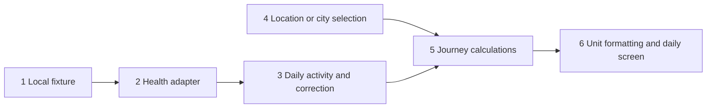
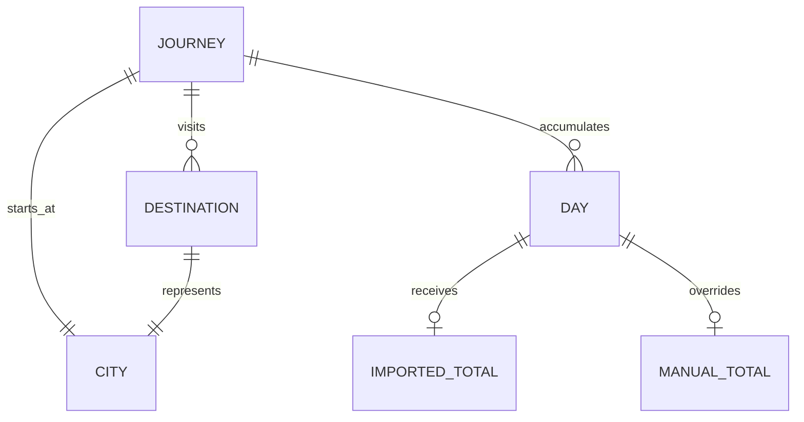
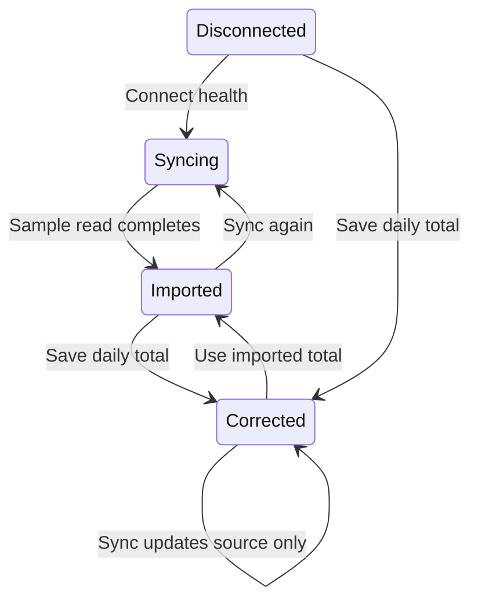

# Journey activity tracker

**Status:** Implementation in progress. S1 (daily journey and simulated health sync) is implemented; later slices remain planned.

## Problem

Repeated local walks accumulate distance without a lasting sense of discovery. A daily activity total provides immediate feedback, but little to collect or continue over several months. The product hypothesis is that a virtual journey through real places can make that accumulated effort more meaningful.

The daily screen will show activity advancing a journey, the next destination, and a growing passport collection. Activity arrives through a simulated health connection and can be corrected manually. Distances are available in metric and imperial units.

## Shape

Reuse the existing Next.js, React, TypeScript, and local JSON scaffold. Keep distance conversion, source reconciliation, destination selection, and reward rules in pure functions that can be tested independently of rendering.

1. `data/sample.json` (exists) supplies sample activity and geographic fixtures through `lib/data.ts` (exists).
2. A health-source adapter (new) simulates an asynchronous distance import into daily activity state. Stable source/day identities prevent duplicate imports.
3. A daily-total editor in `app/page.tsx` (exists) stores an optional manual correction for the same day. The correction replaces the imported total.
4. Browser geolocation or city selection supplies an origin. A city adapter (new) normalizes city coordinates and supplies candidates for nearby destinations.
5. Journey calculations (new) derive accumulated meters, upcoming destinations, and earned stamps from effective daily activity and the selected origin.
6. Distance formatting (new) renders metric or miles; `app/page.tsx` displays the journey using reusable vector assets.

New: in-memory activity, origin, destination, and presentation state. These entities do not imply a database.

The return-to-import control is represented in the design study. Its final wording and availability remain part of interaction review.

| Existing surface | Change |
| --- | --- |
| Root page | Replace the scaffold with one mobile daily experience and contextual sheets |
| Sample goal data | Replace placeholder items with activity and geographic fixtures |
| Styling | Introduce a consistent teal vector visual system |
| Persisted data | No migration; persistence policy is still open |

## Surface

| Surface | Input | Output | Access |
| --- | --- | --- | --- |
| `/` | Activity source, daily correction, units, starting location | Journey, current distance, next city, collected stamps | Public; no account |
| Browser location | Explicit tap on “Use my location” | Coordinates or a manual-selection fallback | Browser permission; secure context |
| City search | City name and optional state | Named matches with coordinates | Public API with local fallback |

No application backend, authentication, payment processing, or native health SDK is introduced.

### One-page composition

Use one route, `/`, implemented through `app/page.tsx`, with vertical scrolling.
The default order is journey map/next city, today's activity, activity history,
then a compact passport preview that expands inline. The Month / Year switch
replaces the history content in place. City selection and daily correction use
contextual bottom sheets; arrival uses a transient overlay on the same page.
Only the yearly grid has internal horizontal scrolling. No separate history,
passport, settings, or onboarding routes are required.

The static boards depict states of this page, not additional routes. The existing
full-page artwork places the passport before history; use the composition above
when implementing and update that comparison artifact during visual integration.

## Technical decisions

### Distance and activity

- Store canonical distance in integer meters. Convert decimal miles once at entry using 1 mile = 1,609.344 meters; round only when accepting the physical value.
- Effective daily distance is `manualOverrideMeters ?? importedMeters ?? 0`. Zero is a valid correction.
- Merge imports by source/day identity. Re-reading an identical source record cannot add distance or repeat an arrival.
- Keep the imported value when a manual override exists. A later import must not silently remove the correction.
- Formatting never writes back into stored distance. Repeated unit switches and unchanged saves must not introduce rounding drift.
- The habit is walking and running distance. Health integration is a local simulation identified by a compact “Demo” label. It updates the journey without a second manual save.
- Earned stamps are recalculated from corrected accumulated distance. Arrival announcements are tracked separately so an identical re-sync cannot replay them.

### Origin and city discovery

- Use `navigator.geolocation.getCurrentPosition` on an explicit gesture for starting-location coordinates. This requires no paid service or API key; the browser requests permission and uses its available location providers.
- Location establishes an origin; it does not record the person's walking route or measure daily activity. Health data and manual totals supply that distance.
- Offer manual city search independently of location permission. A location denial or timeout keeps the picker usable. Simulation, when needed for a demo, is explicitly marked rather than presented as a measured location.
- Open-Meteo's Geocoding API is the proposed city-search provider: it returns names, administrative areas, and coordinates without a key for non-commercial use. The take-home uses a local fallback when requests are slow or unavailable. A commercial deployment would require a fresh provider/terms decision.
- Use the city name, state, and country to distinguish duplicate names. Normalize external results behind one adapter. Do not treat a text-search endpoint as a radius/nearby-city service.
- Rank destination candidates by geographic distance from the current stop, exclude previously visited identities, and extend the journey as destinations are reached. The geographic candidate catalog and distance/pacing bounds remain open implementation decisions requiring a small data evaluation.
- Geolocation supplies coordinates, not a city name. Resolve the name from a sufficiently complete local city catalog, or leave it as “Current location” and offer city selection. Do not label a far-away catalog entry as the detected city. The example map is not a fixed origin or itinerary.
- Starting-location changes must not silently destroy accumulated distance or the collection; the exact reset/rebase behavior remains open before that interaction is implemented.

### Visual system and content

- Palette: cool white, deep teal, turquoise, and restrained orange accents. The current proposal's tokens are in `design/journey/game/tokens.json`.
- The journey map and passport collection are the primary visual features. The current game-inspired proposal uses miniature dimensional landmarks, an illustrated trail, a traveler token, and collectible city stamps. Keep the contemporary travel character and concise mobile controls.
- The new map layout is schematic artwork. Geographic coordinates determine distance thresholds independently of the decorative trail. The change from coordinate-proportional geometry to an illustrated game board remains a visual proposal pending review. No new XP, currency, or streak mechanics are implied.
- Keep the default screen free of explanatory paragraphs. Prefer section headings of up to three words and button labels of up to four words. Put longer descriptions behind the information control.
- Icon-only controls retain accessible names and 44px interaction areas. An icon's drawing size is not its touch-target size.
- Use familiar sheets for city selection and manual correction. Retain only short explanatory copy where it prevents a material mistake, such as “Replaces the imported total.”
- Use local SVGs for reusable artwork. Origin, route points, city labels, and live progress remain data-driven. The supplied geographic route is a visual fixture, not the production map for every city.
- City-specific motifs are available for the sample collection, with neutral city, harbor, and mountain motifs for extension. Never associate a specific landmark illustration with an unrelated city.
- Stamps include earned and future variants. Long city names need readable wrapping or an adjacent HTML label, not arbitrarily shrinking text.

### Activity history

- Add a monthly calendar after the passport, with one square per calendar day. A Month / Year switch offers a GitHub-style contribution grid: seven weekday rows and continuous week columns, with month labels across the top. The year never restarts into separate monthly calendars. The grid scrolls horizontally inside its own mobile container; the page itself stays within the viewport.
- The proposed six-band scale goes from pale green through yellow-green and amber to orange: `#C9E9D9`, `#9ED5BA`, `#CFDF95`, `#EDCD7B`, `#EF9A59`, `#E87C3B`. Use equal distance bands from zero to the maximum effective daily meters in the displayed month or year; one scale applies throughout the displayed period. A revised maximum may recolor the period. Unit switching cannot recolor it. This is distance intensity, not goal completion.
- Confirmed zero is neutral; future dates are outlined. Missing records remain unrecorded, not inferred zero. Guard periods with no positive values against division by zero. Use a short Less / More key and a selected-day date/distance readout.
- Keep day numbers and a selected outline. Monthly squares expose date and distance through accessible names and keyboard navigation. The yearly grid uses roving keyboard focus and arrow-key date selection with an exact date/distance readout. Keep a monthly view for precise touch selection; do not assign overlapping 44px targets to densely packed yearly cells. Use a seven-column roving-focus calendar on narrow screens rather than making the page wider.
- Group records by the same local calendar dates as the daily editor, respecting the configured timezone, real month lengths, weekday offsets, and leap years. Do not derive local dates by slicing UTC timestamps.
- All runtime history, daily totals, and journey calculations use the same effective activity records, including corrections and valid zero values. The separate history design fixture illustrates a longer account history; consolidate it with the short route fixture into one consistent sample account before implementation.
- The continuous contribution-grid layout follows the requested yearly direction. Scale and interaction details remain review proposals. Numeric streaks, missed-day penalties, and monthly goals remain separate product choices.

## Landing

No persisted schema, production contract, or paid dependency is added. The geocoding service sits behind a replaceable client adapter. The sample route, asset styling, component decomposition, and in-memory data types remain reversible.

External assets and data require provenance. The local SVG artwork is original project artwork; the independent Canva study is a design reference, not a stock-asset license or a runtime dependency.

## Criteria

### S1: View an automatically advancing journey

1. WHEN the simulated health source returns activity THEN the screen SHALL update the daily total and journey without requiring a manual save.
2. WHEN an identical source/day record is imported again THEN the accumulated meters SHALL remain unchanged.
3. WHEN effective cumulative distance crosses a destination threshold THEN the screen SHALL display the arrival and its stamp.
4. WHILE the connection is simulated THEN the source status SHALL include “Demo”.

### S2: Change units and correct activity

5. WHEN the unit selector changes THEN every distance label SHALL use the selected system without changing stored meters, progress, targets, or rewards.
6. WHEN a manual daily total is saved THEN it SHALL replace that day's imported total in journey calculations.
7. WHILE a manual correction exists THEN subsequent imports SHALL preserve the correction as the effective daily value.
8. IF the correction is zero THEN the effective value SHALL be zero rather than the imported value.
9. WHEN editing is canceled THEN saved distance SHALL remain unchanged.
10. WHEN an unchanged formatted value is saved THEN the original physical distance SHALL be preserved.

### S3: Start locally and continue to nearby cities

11. WHEN “Use my location” is activated THEN the application SHALL request browser location permission and show a usable origin or a city-selection fallback.
12. WHEN a city-search result is selected THEN the journey SHALL use that city's normalized coordinates as its origin.
13. IF city lookup fails or times out THEN the picker SHALL offer local sample cities without blocking the rest of the screen.
14. WHEN a next destination is needed THEN the application SHALL suggest a nearby unvisited candidate and extend the journey automatically.
15. WHILE named location data is unavailable THEN the application SHALL avoid presenting an unrelated city as the detected location.

### S4: Deliver the reviewed mobile experience

16. The screen SHALL work at 360px and 390px viewport widths without horizontal page scrolling.
17. The map, next destination, accumulated distance, daily activity, and passport SHALL remain readable without explanatory paragraphs.
18. WHEN reduced motion is enabled THEN arrival and progress updates SHALL remain understandable without animation.
19. WHEN an icon control receives keyboard focus THEN it SHALL have a visible focus treatment and an accessible name.
20. The reusable graphics SHALL be present locally before application implementation begins.

### S5: Explore monthly and yearly activity history

21. WHEN a month is displayed THEN it SHALL contain one correctly positioned square per actual calendar day, including leap days.
22. WHEN effective daily distance changes THEN history, selected-day distance, and journey SHALL reflect the same corrected record without adding imported distance again.
23. WHEN units change THEN history labels SHALL convert without changing stored meters or color bands.
24. WHEN a period has positive activity THEN higher daily distances SHALL occupy progressively higher bands on one shared green-to-orange scale for that period.
25. WHEN a monthly day is selected THEN its date and distance or unrecorded/future status SHALL be available without relying on color.
26. WHEN Year is selected THEN a continuous contribution grid SHALL arrange days in seven weekday rows and week columns, with month labels and horizontal scrolling confined to the grid; selected dates SHALL expose their distance through the readout.
27. WHILE a day is future or unrecorded THEN it SHALL NOT appear as confirmed zero activity.

## Design artifacts

These are design studies awaiting visual review, not a claim that the application is implemented.

- [Current screen board](../design/journey/game/design-board.png): playful journey, arrival, and daily correction.
- [Complete Canva review set](https://www.canva.com/d/wfBbyy10pavjL25): fourteen imported screens/boards with native text and illustration elements; local SVGs remain the geometry source. Import rendering still needs visual review.
- [Current asset board](../design/journey/game/asset-board.png): dimensional landmarks, collectible stamps, and palette.
- [Activity history board](../design/journey/game/history-board.png): monthly day squares and proposed yearly overview.
- [Full daily page](../design/journey/game/screen-journey-full.png): scroll continuation of the collection.
- [Current asset handoff](../design/journey/game/README.md): file inventory, reuse rules, and provenance; includes city-picker and health states.
- [Earlier travel-journal study](../design/journey/README.md): retained for comparison.
- [Canva portrait study](https://canva.link/15830ispzmw7buz): editable exploration; the local SVG screens provide the exact 390px mockups.

## Delivery and validation

Use the single branch `feat/habit-tracker-home`. Implement one observable vertical
slice at a time, checking and committing each before the next. Keep behavior and
its relevant tests together. If a slice becomes too large, split it at a coherent
working behavior boundary. Do not add co-author trailers.

| Commit | Scope and reviewable outcome | Validation |
| --- | --- | --- |
| `chore: add project skills and development guidance` | Three complete local skills, pinned provenance, licenses, and agent rules | Verify file hashes, attribution, and staged changes |
| `docs: define journey experience and visual assets` | Neutral technical spec, current game-map graphics, stamps, icons, calendar/contribution-grid studies, and asset handoff | Resolve local links; parse and visually inspect SVGs; distinguish current references from earlier studies |
| `feat: add daily journey with simulated health sync` | One-page journey and today's total, local sample data, automatic simulated import, destination arrival and stamp preview | Test source/day deduplication, distance thresholds, and arrival replay; use the page at phone size |
| `feat: add units and daily distance correction` | Metric/miles control, meter entry, replacement correction, and return to imported value | Test zero overrides, import preservation, rounding, unchanged saves, and visible labels |
| `feat: add starting city and nearby destinations` | Explicit browser location, city picker/search with local fallback, automatic nearby route extension | Test candidate identity/order, unavailable API fallback, and the agreed origin-change policy |
| `feat: add monthly activity calendar` | Daily squares, green-to-orange distance scale, period navigation, exact selected-day readout, shared activity records | Test month boundaries, leap years, unknown versus zero, corrections, and unit-invariant colors |
| `feat: add yearly activity contribution grid` | Continuous week columns and seven day rows, month labels, internal horizontal scroll, date selection | Test date placement across year boundaries; use keyboard and touch navigation at phone width |
| `feat: complete passport collection interactions` | Expandable inline collection and reviewed arrival presentation using the original assets | Verify stamp counts, the agreed correction/retention rule, long names, and reduced motion |
| `fix: refine mobile layout and accessibility` | Measured visual refinements, final section order, focus and sheet behavior; resolve review findings | Run required lint/build/tests and inspect the complete experience in a browser |

The first journey slice includes the initial stamp and arrival behavior; the later
passport slice completes browsing and visual polish rather than deferring the
reward rules. If review finds no fixes, omit an empty final fix commit.
Commit descriptions explain technical changes and validation.

For every implementation commit, provide a plain-language explanation of the
change, its purpose, the data flow, the checks run, and its principal tradeoff.
Keep code small and direct enough for a live extension. Maintain concise setup
and architecture guidance in the repository documentation.

The repository carries [three project-local skills](skills.md), including source revision and attribution. The current work uses TLC's planning structure and frontend-design guidance; the best-practices skill is available for implementation. Installation does not constitute a completed audit or an approved build plan.

### Implementation progress

- Foundation: `f78bba9` records the skills, design assets, and technical guidance together before application implementation.
- S1: the page composes the original landmark/scenery SVGs with live route progress, daily distance, and stamp states. A local asynchronous health adapter imports a daily total automatically. Pure functions in `lib/journey.ts` calculate distance and arrivals; a reducer prevents duplicate imports and arrival replay. `lib/data.ts` loads the local JSON fixture.
- Styling uses plain CSS with shared tokens. The unused Tailwind CSS loader was removed from `next.config.ts`; no component framework or new runtime dependency was added. The font stack uses Ubuntu Sans when available and local sans-serif fallbacks, avoiding a build-time font download.
- Verification for S1: five rule tests pass, ESLint passes, production build passes, and the running page was exercised at 360px, 390px, and 1024px. Browser checks cover automatic import, new-city arrival, unchanged re-sync, Escape dismissal, reduced motion, and absence of page runtime errors. Later slices and the final independent review are still pending.

Test rules that change distance, identity, ordering, or rewards through their public behavior. Inspect the main and sheet states at phone size, with both units, keyboard interaction, and reduced motion. Run the repository's lint and build commands and exercise the app in a browser. A fresh review follows implementation; record actual results rather than anticipated passes.

No remote publishing or deployment is part of this phase.

## Out of scope

| Capability | Reason |
| --- | --- |
| Real health records or native SDK integration | The requested connection is simulated in this web take-home |
| Continuous GPS activity tracking | Location is used to establish a starting place; distance has separate sources |
| Backend, database, auth, real payments | Challenge constraints |
| Full onboarding and comprehensive edge-state suite | Keep the main daily moment focused; retain only necessary location/API fallbacks |

## Open decisions

Before the affected behavior is implemented: daily target, if included; default unit and metric summary formatting; city catalog and destination pacing bounds; treatment of a changed origin; persistence; weekly/monthly goals; paid-feature preview content. The habit is walking/running distance, and stamps recalculate after corrections. The mockup's numbers and DC corridor are illustrative fixtures.

Implementation proceeds in the documented slices. The initial screen does not yet include unit switching, daily correction, origin selection, or activity history; these remain part of the delivery sequence.

## Sources

- Repository `README.md` and `AGENTS.md` provide the challenge constraints.
- [Geolocation API](https://developer.mozilla.org/en-US/docs/Web/API/Geolocation_API) documents permission, secure-context requirements, and coordinate access.
- [Open-Meteo geocoding](https://open-meteo.com/en/docs/geocoding-api) documents city matching, coordinates, optional API keys, and GeoNames attribution.
- [Android Health Connect](https://developer.android.com/health-and-fitness/health-connect) is the platform reference for the simulated source.
- [TLC spec lean](https://github.com/tech-leads-club/agent-skills/blob/main/packages/skills-catalog/skills/%28development%29/tlc-spec-lean/SKILL.md), Tech Leads Club, CC BY 4.0: planning structure adapted for the technical specification.
